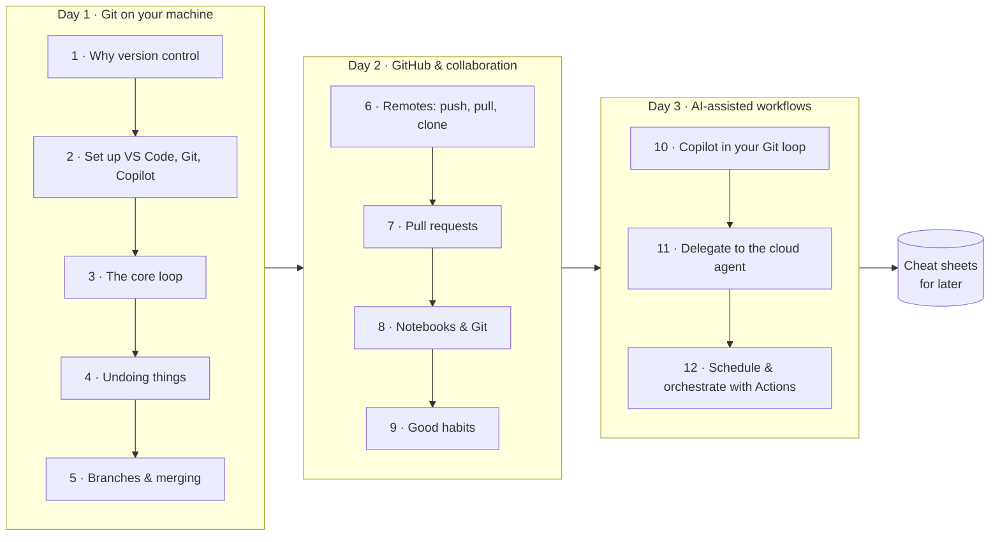
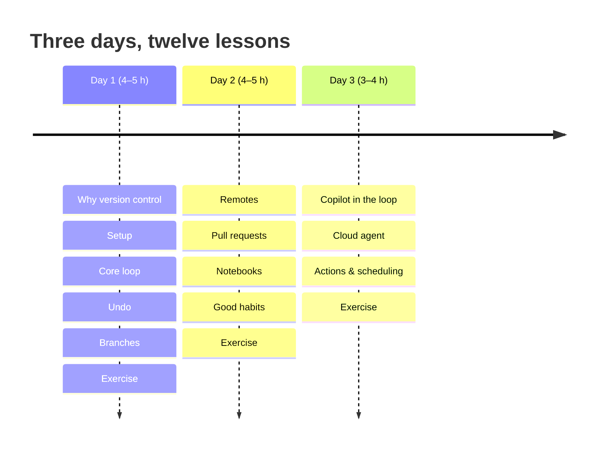
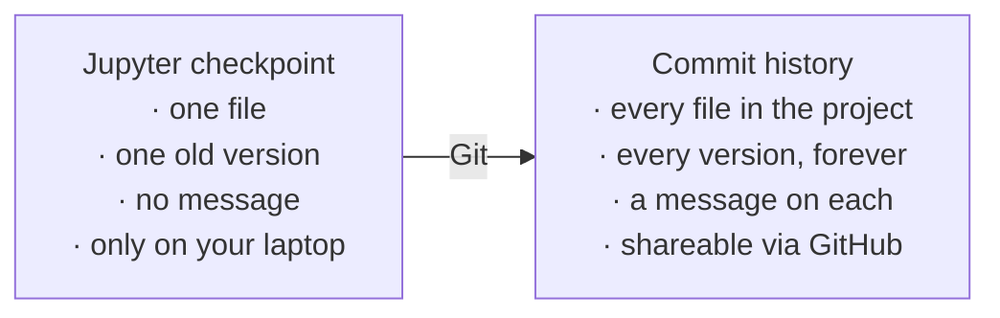

# Git, GitHub & AI agents — from Jupyter to pull requests in two days

You write Python in Jupyter. You have never used Git. You want to work in
**VS Code**, let **GitHub Copilot** help, and eventually hand whole tasks to
**AI agents** that run on a schedule and open pull requests for you.

This course gets you there. Days 1 and 2 teach Git and GitHub properly, with
VS Code as the main tool and the terminal shown alongside. Day 3 is the
payoff: Copilot in your daily loop, delegating work to the Copilot cloud
agent, and scheduling automation with GitHub Actions.

> [!NOTE]
> **Why learn Git when AI writes the code?** Because Git is the steering wheel
> and the brakes. Agents produce changes fast; branches keep each agent's work
> separate, commits make it reviewable, pull requests gate what reaches `main`,
> and if anything goes wrong you can rewind. Every AI-coding workflow on GitHub
> is built on the ideas in Days 1 and 2.

## The map

## How to use this course

1. **Go in order.** Each lesson is 15–45 minutes of reading plus hands-on
   practice. Do the practice; Git is learned through the fingers.
2. **Keep VS Code open** with this folder loaded and a terminal panel showing.
   Every action is shown two ways:

   | ⌨️ Terminal | 🖱️ VS Code |
   |------------|-----------|
   | the command, so you understand what really happens | the click path or shortcut you will actually use |

3. **End each day with its exercise file.** It ties the lessons together.
4. **Keep `cheatsheets/`.** That folder is what you will open six months from now.

### Icons used throughout

| Icon | Meaning |
|------|---------|
| 🎯 | What you will be able to do after the lesson |
| 🧪 | Try it now, hands-on |
| 🧠 | Mental model worth memorising |
| 🤖 | Copilot or AI-agent angle |
| ⌨️ / 🖱️ | Terminal way / VS Code way |

Diagrams are written in [Mermaid](https://mermaid.js.org). GitHub renders
them automatically. In VS Code, install the extension **Markdown Preview
Mermaid Support** (lesson 2) and open any lesson with *Markdown: Open
Preview* (`Ctrl+Shift+V`, Mac `⇧⌘V`).

## Schedule

### Day 1 — Git on your own computer

| # | Lesson | Time | You will be able to… |
|---|--------|------|----------------------|
| 1 | [Why version control?](day-1/01-why-version-control.md) | 15 min | explain what Git solves, and why it matters more with AI |
| 2 | [Set up VS Code, Git, GitHub and Copilot](day-1/02-setup-vscode-git-copilot.md) | 30 min | have a working toolkit and know your way around VS Code |
| 3 | [Your first repo: the core loop](day-1/03-first-repo-the-core-loop.md) | 45 min | stage, commit, diff, read history, in VS Code and the terminal |
| 4 | [Undoing things](day-1/04-undoing-things.md) | 40 min | recover from every common mistake |
| 5 | [Branches](day-1/05-branches.md) | 45 min | work on ideas in parallel, merge them, resolve conflicts |
| — | [Day 1 exercise](day-1/day-1-exercises.md) | 60 min | build a small project with a clean history |

### Day 2 — GitHub and working with others

| # | Lesson | Time | You will be able to… |
|---|--------|------|----------------------|
| 6 | [GitHub and remotes](day-2/06-github-and-remotes.md) | 45 min | publish a repo, push, pull, clone, survive a rejected push |
| 7 | [Pull requests and collaboration](day-2/07-pull-requests-and-collaboration.md) | 45 min | propose changes with a PR, review, use issues, ask Copilot to review |
| 8 | [Jupyter notebooks and Git](day-2/08-jupyter-notebooks-and-git.md) | 30 min | keep notebooks diff-able and your repo clean |
| 9 | [Good habits](day-2/09-good-habits.md) | 30 min | write good commits, `.gitignore`, README, tags |
| — | [Day 2 exercise](day-2/day-2-exercises.md) | 60 min | publish your project and collaborate with yourself |

### Day 3 — AI-assisted and automated workflows

| # | Lesson | Time | You will be able to… |
|---|--------|------|----------------------|
| 10 | [Copilot in your Git loop](day-3/10-copilot-in-your-git-loop.md) | 40 min | use Copilot for commit messages, diff review, and teach it your repo |
| 11 | [Delegating to the Copilot cloud agent](day-3/11-copilot-cloud-agent.md) | 45 min | assign an issue to an agent, review its PR, set guardrails |
| 12 | [Scheduling and orchestration with GitHub Actions](day-3/12-github-actions-scheduling-orchestration.md) | 60 min | run tests on every PR, run notebooks nightly, schedule AI tasks |
| — | [Day 3 exercise](day-3/day-3-exercises.md) | 60 min | automate your project end to end |
| — | [Self-check quiz](self-check-quiz.md) | 20 min | confirm it stuck |

> [!TIP]
> **Only have one day?** Do lessons 1, 2, 3, 5, 6, 7, then the Day 2 exercise.
> Read 4, 8, 9 and all of Day 3 later; they are built as reference material.

## Cheat sheets (keep these)

| Sheet | Open it when… |
|-------|---------------|
| [Git commands](cheatsheets/git-commands.md) | you forgot a command or a flag |
| [VS Code for Git](cheatsheets/vscode-git.md) | you want the click path or shortcut for a Git task |
| [GitHub workflow](cheatsheets/github-workflow.md) | you need the step-by-step for a PR, fork or new repo |
| [Copilot & agents](cheatsheets/copilot-and-agents.md) | you want Copilot shortcuts, instruction files, or agent commands |
| [GitHub Actions](cheatsheets/github-actions.md) | you are writing or debugging a workflow or a cron schedule |
| [Fix it! Recovery](cheatsheets/fix-it-recovery.md) | you made a mistake and need the way out |
| [Jupyter + Git](cheatsheets/jupyter-git.md) | notebooks cause merge pain or huge diffs |
| [Glossary](cheatsheets/glossary.md) | a word in an error message or tutorial is unfamiliar |

## Progress tracker

Copy this into an issue on your own repo (lesson 7 shows how) and tick as you go.

- [ ] Day 1 · lessons 1–5 and exercise
- [ ] Day 2 · lessons 6–9 and exercise
- [ ] Day 3 · lessons 10–12 and exercise
- [ ] Quiz score 16+ / 20 on Days 1–2 questions
- [ ] A repo of mine is on GitHub with tests running on every pull request

## 🧠 The one mental model

Think of Git as **"Save and Checkpoint" in Jupyter, done properly**:

Git is the tool. GitHub is the website that hosts Git repositories and adds
collaboration and automation on top. Copilot and other agents are
contributors that use exactly the same branches, commits and pull requests
you will learn to use yourself.
