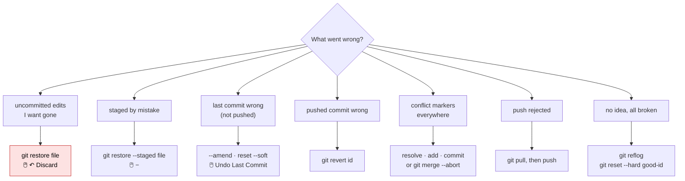

# Fix it! — recovery cheat sheet

Find your situation, run the fix. Before anything drastic: `git status`, and
read it. Nothing committed is ever truly lost (last section).



## Uncommitted changes

| Situation | Fix |
|-----------|-----|
| edits to a file I want gone | `git restore <file>` · 🖱️ ↶ Discard Changes (irreversible) |
| **all** uncommitted edits gone | `git restore .` then `git clean -fd` for untracked files (preview with `git clean -n`) |
| staged a file by mistake | `git restore --staged <file>` · 🖱️ − |
| need to switch branch mid-work | `git stash`, switch, `git stash pop` · 🖱️ … → Stash |
| "would be overwritten by checkout" | commit or stash first |
| deleted a file by accident (not committed) | `git restore <file>` |
| deleted a file and committed it | `git restore --source HEAD~1 <file>`, commit |

## Last commit (not yet pushed)

| Situation | Fix |
|-----------|-----|
| typo in the message | `git commit --amend -m "Fixed message"` |
| forgot a file | `git add <file>` then `git commit --amend --no-edit` |
| committed too much, want to split | `git reset --soft HEAD~1` · 🖱️ Undo Last Commit, then re-add in pieces |
| committed on the wrong branch | `git branch correct-branch` · `git reset --hard HEAD~1` · `git switch correct-branch` |
| commit and its changes both gone | `git reset --hard HEAD~1` |
| commit gone, keep changes to rework | `git reset HEAD~1` |
| committed a secret | rotate the secret **now**; then `git reset --soft HEAD~1`, remove it, recommit. Once pushed, rotating is the only real fix |

## Older or already-pushed commits

| Situation | Fix |
|-----------|-----|
| a pushed commit was wrong | `git revert <id>` then push |
| several pushed commits wrong | revert each, newest first |
| see the project as it was at X | `git checkout <id>` · 🖱️ Graph → Checkout; back with `git switch main` |
| one file as it was at X | `git restore --source <id> <file>` |
| amended/reset a pushed commit; push rejected | nobody else pulled it: `git push --force-with-lease`; otherwise pull, accept the mess, revert next time |

## Branches

| Situation | Fix |
|-----------|-----|
| deleted a branch I needed | `git reflog` → find its last commit → `git switch -c <name> <id>` |
| detached HEAD and I made commits | `git switch -c save-my-work` |
| detached HEAD, no commits | `git switch main` |
| merge went wrong | `git merge --abort` during; `git reset --hard HEAD~1` after, if the merge commit is last and unpushed |
| rebase went wrong | `git rebase --abort` |
| branch far behind main | `git switch my-branch && git merge main`, resolve |

## Merge conflicts

1. `git status` lists *Unmerged paths* · 🖱️ *Merge Changes* section.
2. In each file find `<<<<<<<` … `=======` … `>>>>>>>`; keep what you want; delete the markers. 🖱️ Accept Current / Incoming / Both, or the merge editor.
3. `git add <file>` each · 🖱️ +.
4. `git commit` · 🖱️ ✓.

One side wholesale: `git checkout --ours <file>` (mine) or `--theirs` (incoming), then `git add`. Bail out: `git merge --abort`. Conflicted notebook: `nbmerge-web notebook.ipynb`.

## Remote problems

| Message | Meaning | Fix |
|---------|---------|-----|
| `! [rejected] … (fetch first)` / `non-fast-forward` | remote has commits you lack | `git pull`, resolve, `git push` |
| `fatal: not a git repository` | not inside a repo folder | `cd` into it, or `git init` |
| `remote origin already exists` | remote already set | `git remote set-url origin <url>` |
| `no tracking information for the current branch` | branch not linked to remote | `git push -u origin <branch>` |
| `Permission denied (publickey)` | SSH key missing on GitHub | lesson 6; or switch the URL to HTTPS |
| `Authentication failed` | password instead of token, or expired | `gh auth login` or sign in again in VS Code |
| `refusing to merge unrelated histories` | both local and remote were created with content | `git pull origin main --allow-unrelated-histories`, resolve, push |
| `Your local changes would be overwritten by merge` | uncommitted edits in files the pull changes | commit or stash, then pull |
| file over 100 MB rejected | GitHub limit | `git rm --cached`, amend, add to `.gitignore`; consider Git LFS |

## .gitignore not working

| Situation | Fix |
|-----------|-----|
| ignored file still shows as modified | it was committed before being ignored: `git rm --cached <file>`, commit |
| whole folder still tracked | `git rm -r --cached <folder>`, commit |
| not sure why a file is or is not ignored | `git check-ignore -v <file>` |

## "Everything is broken and I do not know what I did"

```bash
git reflog
```

```
a1b2c3d HEAD@{0}: reset: moving to HEAD~2
f9e8d7c HEAD@{1}: commit: The commit I wanted to keep
```

Pick the entry from **before** the mistake:

```bash
git reset --hard f9e8d7c          # go back there
git switch -c rescue f9e8d7c      # or: put it on a new branch and inspect
```

Reflog entries last about 90 days. It recovers deleted branches, bad resets,
bad rebases and lost commits. It cannot recover work that was **never
committed** and was destroyed by `restore`, `reset --hard` or `clean`.

## Nuclear option: fresh clone

If the local repo is hopeless and GitHub has what matters:

```bash
cd ..
mv project project-broken        # keep it, just in case
git clone <url> project
```

Then copy any uncommitted files you still need from `project-broken`.
