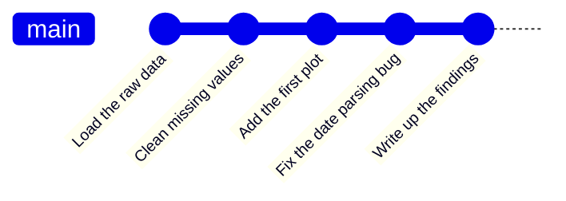
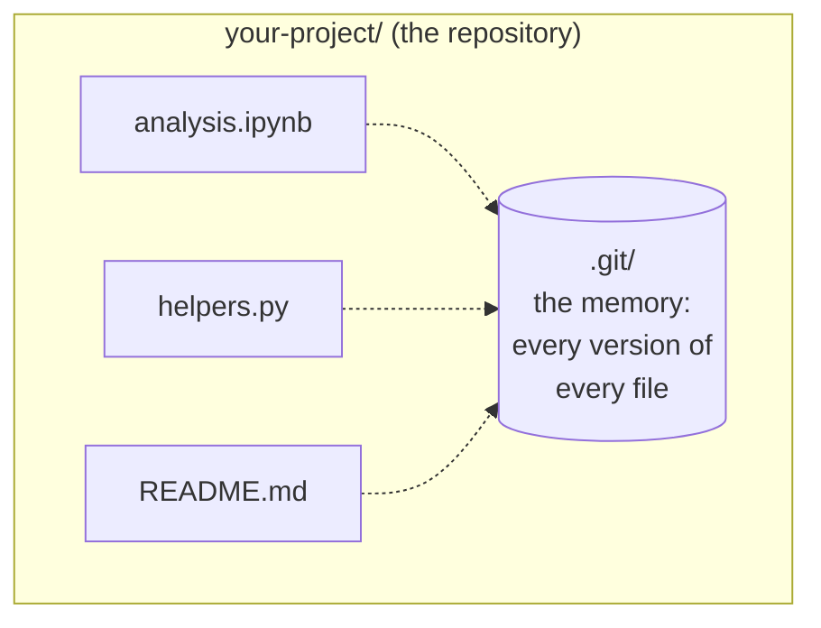
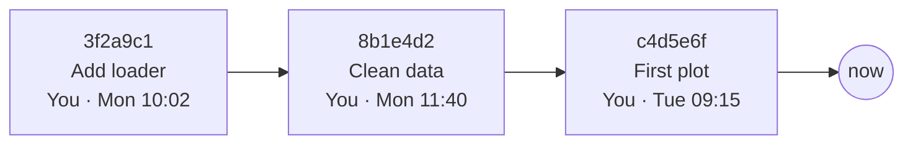
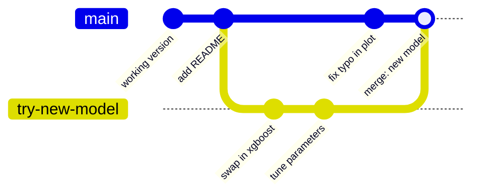
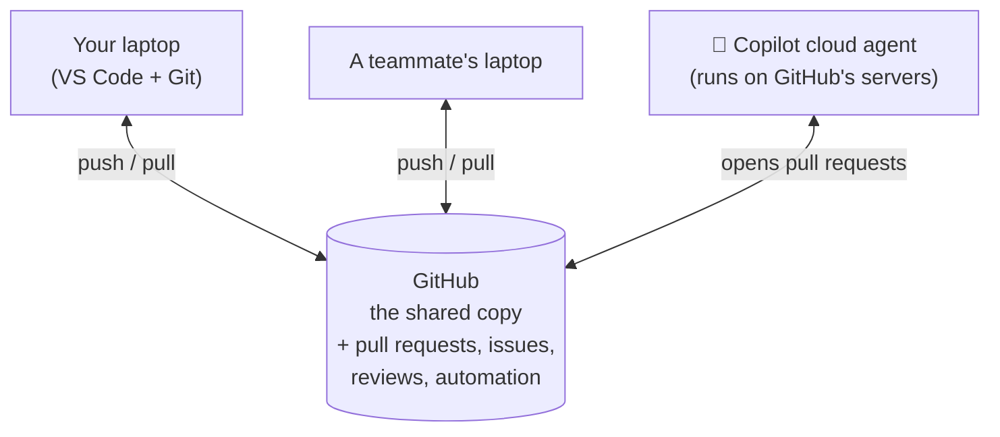
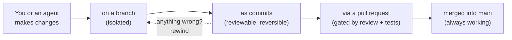

# 1 · Why version control?

> ⏱️ 15 min · 🎯 Explain what Git solves, the three ideas behind it, and why it is the foundation of AI-assisted coding · ⌨️ No typing yet

**Day 1 ▸ Lesson 1 of 5**

## The problem you already have

Open a project folder from last month. Does it look like this?

```
analysis.ipynb
analysis_v2.ipynb
analysis_v2_fixed.ipynb
analysis_FINAL.ipynb
analysis_FINAL_really.ipynb
analysis_FINAL_really (1).ipynb
```

Every data scientist has lived this. It creates four questions nobody can answer:

| Question | Why it hurts |
|----------|--------------|
| Which one is current? | Not even you know, a month later |
| What changed between `v2` and `v2_fixed`? | You would open both and compare by eye |
| Can I go back to the version that worked? | Only if you kept it and remember which it was |
| Can two people (or a person and an AI) work on it? | Email it around and merge by hand |

Version control answers all four. **Git** is the version control system
practically every software project uses. It was written in 2005 by Linus
Torvalds, who also wrote Linux.

## What the same project looks like with Git

One file, one folder, and a history you can read like a diary:



Every dot is a **commit**: a snapshot of the whole project plus a message
saying what changed and why. You can jump to any dot, compare any two dots,
and see exactly who changed what.

## 🧠 The three ideas that make Git click

### 1 · A repository is a folder with a memory



A *repository* (repo) is a normal folder with one hidden sub-folder called
`.git`. That folder stores every version of every file you have ever asked
Git to remember. You never touch `.git` by hand; you talk to it through Git
commands or VS Code buttons. Delete `.git` and the folder becomes an ordinary
folder again; your current files stay, the history is gone.

### 2 · A commit is a snapshot with a message

When you tell Git "remember this", it snapshots all your files, attaches your
name, the date and a message you write, and gives the result an ID. Commits
chain together, each pointing to the one before. That chain is your
project's **history**.



Commits are permanent and cheap. Make many small ones.

### 3 · A branch is a parallel line of history

Want to try a risky idea without disturbing working code? Make a **branch**:
a separate line of commits starting from where you are. When the idea
works, **merge** it back. When it does not, delete the branch and nothing
happened.



Branches are what make collaboration possible: every person, and every AI
agent, works on their own branch and merges when ready.

## Where GitHub fits

Git works entirely on your computer. **GitHub** hosts Git repositories on the
internet and adds a website around them.



When you *push* your repo to GitHub it is backed up, other people and other
machines can *clone* it, and you get a web interface to browse history,
discuss changes, review code and track work. GitLab and Bitbucket are
competitors; the Git commands are identical.

## 🤖 Why this is the foundation of AI-assisted coding

Copilot in VS Code edits files on your machine. The Copilot cloud agent and
tools like Claude Code work on GitHub's servers. Either way, the safety and
the workflow come from Git:



| Git concept | What it does for AI work |
|-------------|--------------------------|
| branch | each agent task lives in its own sandbox |
| commit | every change is recorded and can be undone |
| diff | you see exactly what the agent changed before accepting |
| pull request | nothing reaches `main` without review and passing tests |
| GitHub Actions | runs tests, and can run agents, on a schedule |

By Day 3 you will assign an issue to an agent and review its pull request
using nothing but the skills from Days 1 and 2.

## Vocabulary for today

| Word | Meaning |
|------|---------|
| repository / repo | a folder tracked by Git (has `.git` inside) |
| commit | a saved snapshot with a message |
| history | the chain of commits |
| branch | an independent line of commits |
| merge | combine one branch's commits into another |
| working directory | your actual files on disk, the ones you edit |
| remote | a copy of the repo somewhere else, usually GitHub |

## ✅ Check yourself

- What would you lose if you deleted `.git`? *(The history. Current files stay.)*
- What does every commit carry besides the snapshot? *(Author, date, message.)*
- Is GitHub required to use Git? *(No.)*
- Where does an AI agent's work live before you accept it? *(On its own branch, proposed through a pull request.)*

Next: [2 · Set up VS Code, Git, GitHub and Copilot](02-setup-vscode-git-copilot.md)
