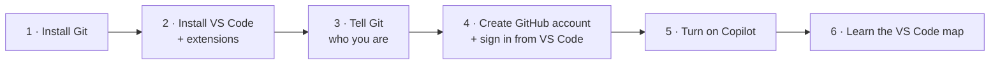
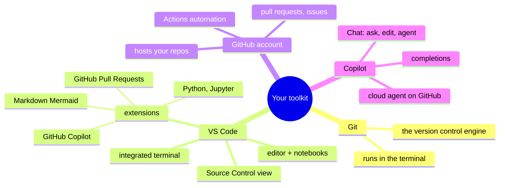

# 2 · Set up VS Code, Git, GitHub and Copilot

> ⏱️ 30 min · 🎯 A working toolkit, Git knowing who you are, VS Code signed in to GitHub, Copilot ready · ⌨️ + 🖱️

**Day 1 ▸ Lesson 2 of 5**



## Your toolkit



## 1 · Install Git

Open a terminal (macOS: Terminal; Windows: PowerShell for now; Linux: any
shell) and type:

```bash
git --version
```

If you see `git version 2.4x.x` or newer, skip ahead.

| OS | How |
|----|-----|
| macOS | the `git --version` prompt offers the Xcode command line tools; accept. Or `brew install git` |
| Windows | download from https://git-scm.com/download/win, run the installer, accept all defaults. This also installs **Git Bash** |
| Linux | `sudo apt install git` (Debian/Ubuntu) or `sudo dnf install git` (Fedora) |

Anaconda users can also `conda install git`.

## 2 · Install VS Code and extensions

Download from https://code.visualstudio.com. Then open the Extensions view
(`Ctrl+Shift+X`, Mac `⇧⌘X`) and install:

| Extension | Why you want it |
|-----------|-----------------|
| **Python** (Microsoft) | run and debug `.py` files |
| **Jupyter** (Microsoft) | open and run `.ipynb` notebooks inside VS Code |
| **GitHub Pull Requests** (GitHub) | create and review pull requests without leaving VS Code (lesson 7) |
| **GitHub Copilot** (GitHub) | completions and chat; the Chat extension comes along with it |
| **Markdown Preview Mermaid Support** | renders the diagrams in this course in the Markdown preview |
| **GitLens** or **Git Graph** (optional) | richer history views; VS Code's built-in graph is enough to start |

Git support itself is built into VS Code. Nothing to install for that.

## 3 · Tell Git who you are

Every commit records an author. Set it once, globally. Use the **same email**
you will use for GitHub so GitHub can link commits to your profile.

```bash
git config --global user.name "Your Name"
git config --global user.email "you@example.com"
git config --global init.defaultBranch main      # new repos start on "main"
git config --global core.editor "code --wait"    # VS Code writes commit messages
git config --global pull.rebase false            # plain merges when pulling (lesson 6)
```

Check with `git config --global --list`. These live in a file called
`~/.gitconfig`.

> [!TIP]
> On Windows, run these in **Git Bash** or in VS Code's terminal after
> step 6 so the commands in this course match exactly.

## 4 · GitHub account, and sign in from VS Code

1. Sign up at https://github.com with the same email. Pick a username you
   are happy to show on a CV; it becomes part of your public URL. Enable
   two-factor authentication when prompted.
2. In VS Code click the **Accounts** icon (bottom of the left Activity Bar)
   → **Sign in with GitHub** → authorise in the browser.

That sign-in is what lets VS Code push and pull for you later. No passwords,
no tokens to manage. The terminal alternatives (GitHub CLI, SSH keys) are in
lesson 6 for when you need them.

## 5 · Turn on Copilot

1. Click the Copilot icon in the status bar (bottom right) or open Chat
   (`Ctrl+Alt+I`, Mac `⌃⌘I`) and follow the sign-in prompt.
2. Plans: there is a **free tier** with a monthly allowance of completions
   and chat messages, and paid plans (Pro, Pro+, Business, Enterprise) with
   more usage and the **cloud agent** used in lesson 11. Prices and
   allowances change often; check https://github.com/features/copilot/plans.
3. Test it: open a new file `hello.py`, type `def fahrenheit_to_celsius(` and
   pause. Grey ghost text appears. Press `Tab` to accept or keep typing to
   ignore.

> [!NOTE]
> Everything in Days 1 and 2 works **without** Copilot. The 🤖 boxes are
> optional extras until Day 3.

## 6 · The VS Code map

```
┌──┬──────────────────────────────────────────────────────────────┐
│🗎 │ EXPLORER            │  hello.py  ×                           │
│🔍│  ▸ weather-project   │                                        │
│⑂ │    temps.py      M   │  def to_fahrenheit(c):                 │
│▷ │    README.md     U   │      return c * 9 / 5 + 32             │
│⧉ │                      │                                        │
│  │  ▸ TIMELINE          ├────────────────────────────────────────┤
│  │    (history of the   │ TERMINAL   ▸ git status                │
│  │     open file)       │ On branch main ...                     │
├──┴──────────────────────┴────────────────────────────────────────┤
│ ⑂ main  ↻   ✓ 0 ⚠ 0                          Ln 2, Col 1  Copilot│
└──────────────────────────────────────────────────────────────────┘
```

| Part | What it is | Shortcut (Win/Linux · Mac) |
|------|-----------|-----------------------------|
| Activity Bar (left edge) | Explorer 🗎, Search 🔍, **Source Control ⑂**, Run ▷, Extensions ⧉ | Source Control: `Ctrl+Shift+G` · `⌃⇧G` |
| Command Palette | type any command by name; the universal escape hatch | `Ctrl+Shift+P` · `⇧⌘P` |
| Integrated terminal | a real shell inside VS Code; this is where ⌨️ commands go | ``Ctrl+` `` · ``⌃` `` |
| Status bar branch name | which branch you are on; click to switch or create | — |
| Timeline (bottom of Explorer) | Git history of the file you have open | — |
| File badges `U` `M` `A` `D` | Untracked, Modified, Added, Deleted since last commit | — |
| Copilot Chat | ask, edit, or let an agent work | `Ctrl+Alt+I` · `⌃⌘I` |

Open the integrated terminal now and run `git --version` there. From here on,
"terminal" means this panel.

## 7 · Terminal survival kit

You need only a handful of shell commands. Tab completes names; up arrow
recalls commands; `Ctrl+C` aborts.

| Command | Does |
|---------|------|
| `pwd` | print the folder you are in |
| `ls` / `ls -a` | list files / including hidden ones like `.git` |
| `cd folder`, `cd ..` | go into a folder / up one level |
| `mkdir name` | make a folder |
| `cat file.py` | print a file |
| `code .` | open the current folder in VS Code |
| `clear` | clear the screen |

In the exercises you will create and edit files in VS Code. The terminal is
only needed for the `git` commands, and even those have buttons.

## ✅ Check yourself

- `git config user.name` and `git config user.email` print your values.
- The status bar shows the Accounts icon signed in to GitHub.
- The Copilot icon in the status bar does not show an error.
- You can open the Source Control view, the Command Palette and the terminal from the keyboard.

Next: [3 · Your first repo: the core loop](03-first-repo-the-core-loop.md)
