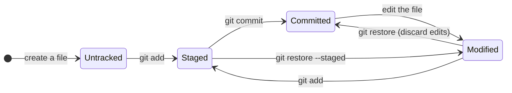
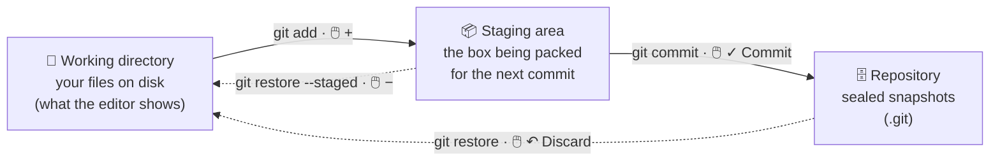
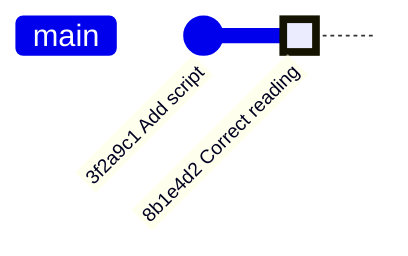
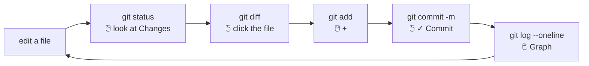

# 3 · Your first repo: the core loop

> ⏱️ 45 min · 🎯 Create a repo, stage, commit, see what changed, read history, in VS Code and in the terminal · ⌨️ + 🖱️ Type everything

**Day 1 ▸ Lesson 3 of 5**

Five actions make up 90 % of daily Git: **status, add, commit, diff, log**.
By the end of this lesson they will be boring. Boring is the goal.

## 🧠 The picture to memorise first

Every file in a repo is in one of these states. The whole lesson is just
moving files around this diagram.



And the three "places" a file lives in, side by side:



## 1 · Create a repository

| ⌨️ Terminal | 🖱️ VS Code |
|------------|-----------|
| `mkdir ~/weather-project && cd ~/weather-project && git init` | *File → Open Folder…* → create and open `weather-project` → Source Control view (`Ctrl+Shift+G`) → **Initialize Repository** |

Either way you get `Initialized empty Git repository in …/weather-project/.git/`.
Run `ls -a` in the terminal: the hidden `.git` folder is there. The status bar
now shows `⑂ main`.

## 2 · The most important command: `git status`

```bash
git status
```

```
On branch main
No commits yet
nothing to commit (create/copy files and use "git add" to track)
```

`git status` tells you where you are and what Git is waiting for. **It never
changes anything.** When in doubt, run it. The VS Code equivalent is simply
looking at the Source Control view: it *is* a live `git status`.

## 3 · Create a file

Make `temps.py` (Explorer → New File) with:

```python
temps_c = [21.5, 23.0, 19.8, 25.1]

def to_fahrenheit(c):
    return c * 9 / 5 + 32

print([to_fahrenheit(t) for t in temps_c])
```

Now look:

| ⌨️ `git status` says | 🖱️ VS Code shows |
|---------------------|-----------------|
| `Untracked files: temps.py` | `temps.py` under **Changes** with a green `U` badge |

**Untracked** means Git sees the file but has never been told to remember it.

## 4 · The two-step save: add, then commit

This is where everyone gets confused, so slowly:

1. **Add** (stage) chooses *which* changes go into the next snapshot.
2. **Commit** takes the snapshot of everything staged, with a message.

Why two steps? You often edit five files but want two separate commits
("fix bug in loader", "add plot"). Staging lets you pick. Think of packing
a box: `add` puts things in, `commit` seals it and writes the label.

| ⌨️ Terminal | 🖱️ VS Code |
|------------|-----------|
| `git add temps.py` | hover `temps.py` under Changes → click **+** (Stage Changes). It moves to **Staged Changes** |
| `git commit -m "Add temperature conversion script"` | type the message in the box at the top → **✓ Commit** (or `Ctrl+Enter`) |

```
[main (root-commit) 3f2a9c1] Add temperature conversion script
 1 file changed, 5 insertions(+)
```

`3f2a9c1` is the start of the commit's ID, a 40-character hash. You refer to
commits by their first 7 characters. `git status` now says `nothing to
commit, working tree clean`, and the Source Control view is empty.

> [!TIP]
> If you click **✓ Commit** with nothing staged, VS Code offers to stage all
> changes for you. Handy, but read the list first (section 9 explains why).

## 5 · Make a change and see it: diff

Edit `temps.py`: change `25.1` to `26.4` and append

```python
print(f"Max: {max(temps_c)} C")
```

| ⌨️ Terminal | 🖱️ VS Code |
|------------|-----------|
| `git diff` | click `temps.py` under Changes: a side-by-side diff opens |

```diff
-temps_c = [21.5, 23.0, 19.8, 25.1]
+temps_c = [21.5, 23.0, 19.8, 26.4]
 ...
+print(f"Max: {max(temps_c)} C")
```

`-` lines were removed, `+` lines added. This answers "what did I change
since my last save?", the question `analysis_v2_fixed.ipynb` never could.
In the editor itself, a green or blue bar in the gutter marks changed lines;
click it to see the old version inline.

`git diff` compares working directory to staging area. Once you stage, plain
`git diff` shows nothing; use `git diff --staged` to see what is about to be
committed. (VS Code: click the file under *Staged Changes*.)

## 6 · Commit the change

| ⌨️ Terminal | 🖱️ VS Code |
|------------|-----------|
| `git add temps.py` then `git commit -m "Correct last reading and print the maximum"` | **+** on the file → message → **✓ Commit** |

Shortcut: `git commit -am "message"` stages every *modified tracked* file and
commits in one go. It never picks up new files; those still need `git add`.

### 🤖 Let Copilot draft the message

In the commit message box there is a **✨ sparkle** button (*Generate Commit
Message with Copilot*). It reads the staged diff and writes a message. Use it,
then **edit it**: it describes *what* changed; you know *why*. Lesson 9 has
the rules for a good message.

## 7 · Read the history: log

| ⌨️ Terminal | 🖱️ VS Code |
|------------|-----------|
| `git log --oneline` | Source Control view → **Graph** section (scroll down in the panel) |
| `git show 3f2a9c1` | click a commit in the Graph → its changed files open as diffs |
| history of one file | open the file → **Timeline** at the bottom of Explorer |

```
8b1e4d2 (HEAD -> main) Correct last reading and print the maximum
3f2a9c1 Add temperature conversion script
```

`HEAD` means "the commit you are standing on". `HEAD -> main` means HEAD is
at the tip of branch `main`. The full `git log` adds author, date and the
whole message.



## 8 · Several files at once

Create `README.md` (a title and one sentence) and `notes.txt`.

| ⌨️ Terminal | 🖱️ VS Code |
|------------|-----------|
| `git add .` (everything new or modified in this folder) | **+** on the *Changes* header (Stage All Changes) |
| `git status` → check the list | read the *Staged Changes* list |
| `git commit -m "Add README and notes"` | message → **✓ Commit** |

## 9 · One rule before you move on

> [!WARNING]
> **Always read what is in the box before you seal it.** `git add .` and
> *Stage All* grab everything, including data files, secrets, and
> `.ipynb_checkpoints/`. Lesson 9 shows `.gitignore`, which keeps junk out
> for good. Until then: `git status`, read, then commit.

## 🧪 Practice loop

Do this five times with small edits to any file, until it is boring:



## Recap

| Command | Meaning | 🖱️ VS Code |
|---------|---------|-----------|
| `git init` | turn this folder into a repository | **Initialize Repository** |
| `git status` | what state are my files in? | the Source Control view |
| `git add <file>` / `git add .` | stage changes | **+** on a file / on *Changes* |
| `git commit -m "msg"` | snapshot the staged changes | message box → **✓ Commit** |
| `git commit -am "msg"` | stage all modified tracked files and commit | Commit with nothing staged → *Yes* |
| `git diff` / `git diff --staged` | what changed, unstaged / staged | click the file |
| `git log --oneline` | compact history | **Graph** section |
| `git show <id>` | what one commit changed | click the commit in Graph |

Next: [4 · Undoing things](04-undoing-things.md)
