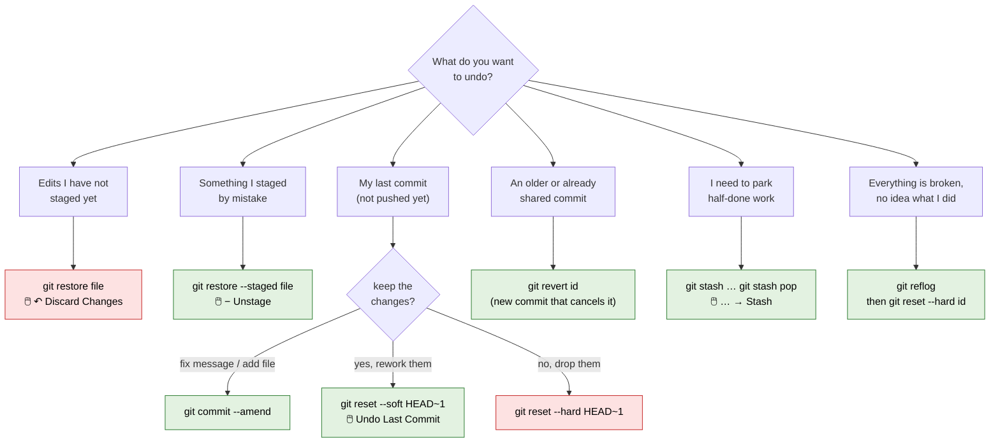
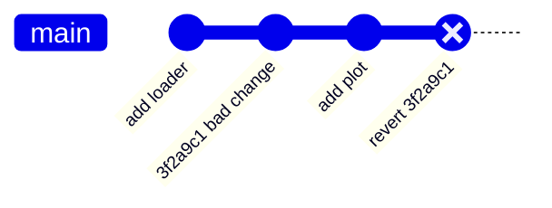
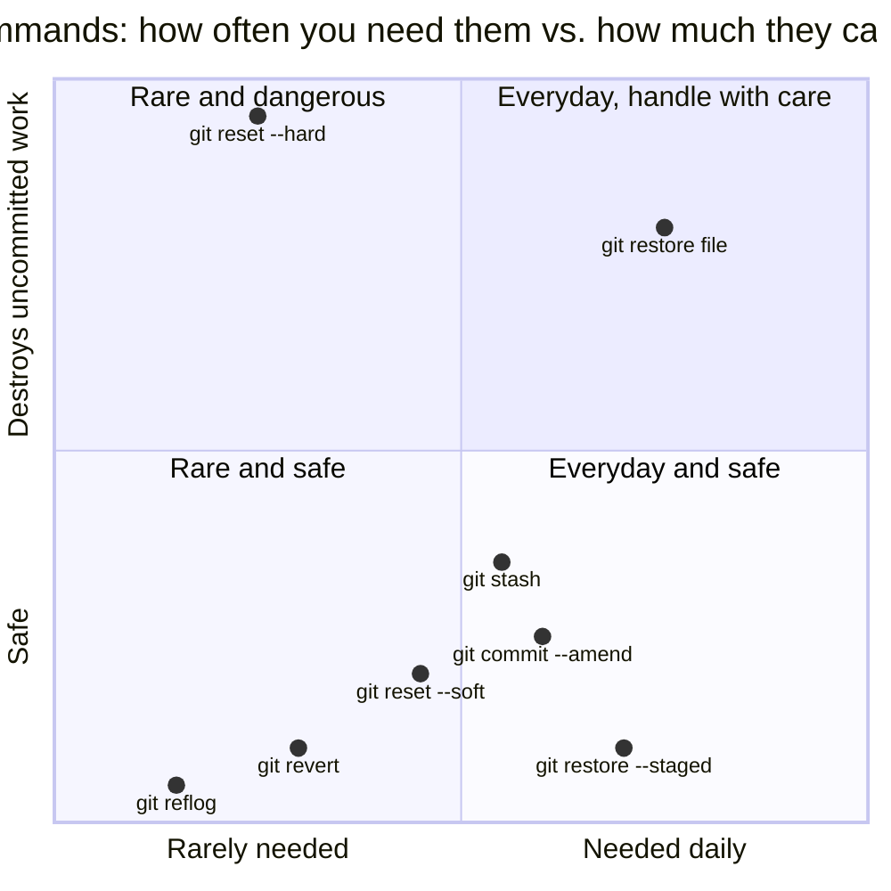

# 4 · Undoing things

> ⏱️ 40 min · 🎯 Recover from every common mistake, and know which undo is safe · ⌨️ + 🖱️ Practise each one in `weather-project`

**Day 1 ▸ Lesson 4 of 5**

The reason to use Git is that mistakes stop being scary. One rule keeps you
safe:

> [!IMPORTANT]
> **Once something is committed it is almost impossible to lose.** Most undo
> commands only touch work that is *not yet committed*, and that is the only
> work at real risk. Commit early, commit often.

## 🧭 Which undo do I need?



Red boxes destroy uncommitted work. Green boxes are reversible.

## 1 · "I edited a file and want the edits gone"

The file is modified, not staged. Get the last committed version back:

| ⌨️ Terminal | 🖱️ VS Code |
|------------|-----------|
| `git restore temps.py` | hover the file under *Changes* → **↶ Discard Changes** → confirm |

**This is destructive.** The edits are gone for good.

🧪 Add a junk line to `temps.py`, look at the diff, discard it, look again.

## 2 · "I staged a file but did not mean to"

| ⌨️ Terminal | 🖱️ VS Code |
|------------|-----------|
| `git restore --staged temps.py` | hover the file under *Staged Changes* → **−** (Unstage Changes) |

Your edits are untouched; only the box was unpacked.

## 3 · "Typo in the message, or I forgot a file"

Only for the **most recent** commit, and only if you have **not pushed** it:

```bash
git commit --amend -m "Better message"      # fix the message
git add forgotten.py
git commit --amend --no-edit                 # add a file, keep the message
```

🖱️ Source Control **…** menu → *Commit* → **Undo Last Commit**, then fix and
commit again. Same result, two steps.

`--amend` *replaces* the last commit with a new one. Never amend a commit
others may already have (lesson 6 explains why).

## 4 · "Undo the last commit but keep my changes"

```bash
git reset --soft HEAD~1
```

`HEAD~1` means "one commit before HEAD". The commit disappears from history;
its changes are back in the staging area, ready to be re-committed
differently. Use this when you committed too early or bundled two things.

The three flavours of reset, gentle to brutal:

| Command | Commit removed? | Changes still staged? | Changes still on disk? |
|---------|-----------------|------------------------|------------------------|
| `git reset --soft HEAD~1` | yes | yes | yes |
| `git reset HEAD~1` (default, "mixed") | yes | no | yes |
| `git reset --hard HEAD~1` | yes | no | **no, deleted** |

🖱️ **Undo Last Commit** in the Source Control menu is the `--soft` version.

## 5 · "That commit from last week was wrong, and it is already shared"

Do not reset: that rewrites history other people have. Make a **new** commit
that does the opposite:

```bash
git revert 3f2a9c1
```



History stays intact; the bad change is cancelled. Safe whenever a commit has
left your machine. 🖱️ Right-click a commit in the Graph → there is no revert
there yet; use the terminal.

## 6 · "Show me the project as it was at an older commit"

| ⌨️ Terminal | 🖱️ VS Code |
|------------|-----------|
| `git log --oneline` → `git checkout 3f2a9c1` → look around → `git switch -` | Graph → right-click the commit → **Checkout** → look around → click the branch name in the status bar → `main` |

While parked on an old commit you are in **detached HEAD** state. Git prints
an alarming message; it just means you are not on a branch. Look, run the
code, come back. To *build* on that old point, make a branch there (lesson
5): `git switch -c from-old-point`.

## 7 · "I just want one old version of one file"

```bash
git restore --source 3f2a9c1 temps.py
```

🖱️ Open the file → **Timeline** → click an old entry to see it → copy what
you need, or use the terminal command.

## 8 · "I must switch tasks but I am mid-way through something"

| ⌨️ Terminal | 🖱️ VS Code |
|------------|-----------|
| `git stash` … later `git stash pop` | Source Control **…** → *Stash* → **Stash** … later → **Pop Latest Stash** |

`git stash list` shows what is parked; `git stash -u` includes untracked
files. A stash is a pocket, not an archive; commit properly when you can.

## 9 · "I did something and now everything is broken"

Git keeps a diary of every place HEAD has pointed for about 90 days:

```bash
git reflog
```

```
a1b2c3d HEAD@{0}: reset: moving to HEAD~1
8b1e4d2 HEAD@{1}: commit: Correct last reading and print the maximum
3f2a9c1 HEAD@{2}: commit (initial): Add temperature conversion script
```

Find the entry from just *before* the disaster and go back:

```bash
git reset --hard 8b1e4d2
```

This recovers lost commits after a bad reset, a deleted branch, a bad
rebase. The only thing it cannot recover is work that was never committed.

## 📊 How dangerous is each undo?



## 🧪 Practice

In `weather-project`, do each one:

1. Make an edit, discard it (both ways).
2. Stage a file, unstage it (both ways).
3. Commit, then amend the message.
4. Commit, then `git reset --soft HEAD~1`, then re-commit with a better message.
5. Revert your newest commit; look at the Graph.
6. Check out your very first commit from the Graph, open `temps.py`, return to `main`.
7. Stash an edit, confirm the file is clean, pop it back.
8. Run `git reflog` and read the story it tells.

## Recap

| I want to… | Command | 🖱️ VS Code |
|------------|---------|-----------|
| discard unstaged edits | `git restore <file>` | ↶ Discard Changes |
| unstage | `git restore --staged <file>` | − Unstage |
| fix the last commit (unpushed) | `git commit --amend` | Undo Last Commit, redo |
| undo last commit, keep changes | `git reset --soft HEAD~1` | … → Commit → Undo Last Commit |
| undo last commit, drop changes | `git reset --hard HEAD~1` | terminal |
| cancel a shared commit safely | `git revert <id>` | terminal |
| look at an old commit | `git checkout <id>` … `git switch main` | Graph → Checkout |
| get one old file back | `git restore --source <id> <file>` | Timeline |
| park work | `git stash` / `git stash pop` | … → Stash |
| find anything I lost | `git reflog` | terminal |

Next: [5 · Branches](05-branches.md)
