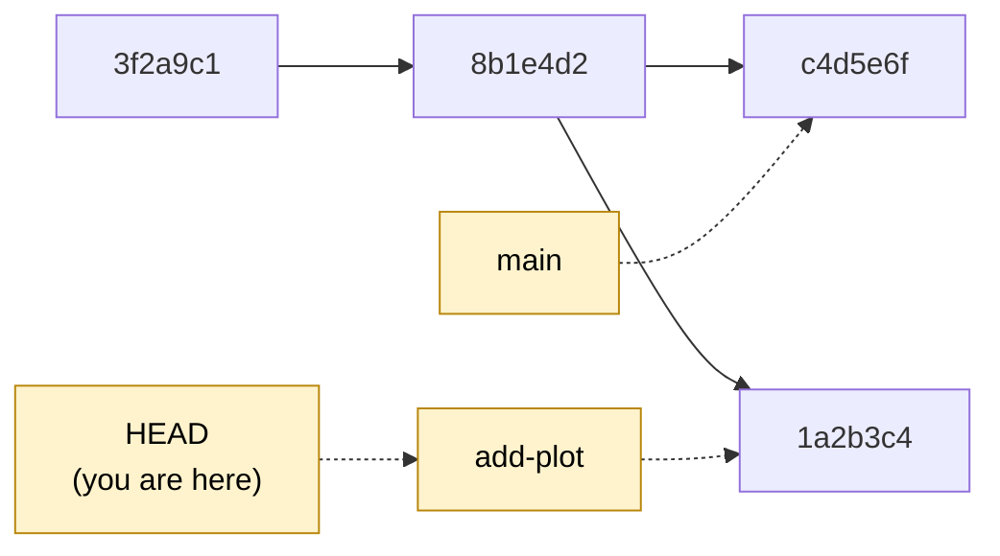
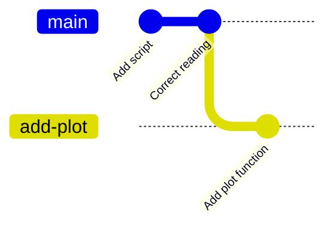
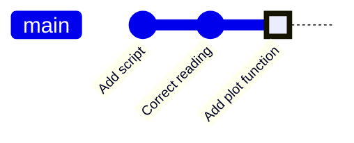
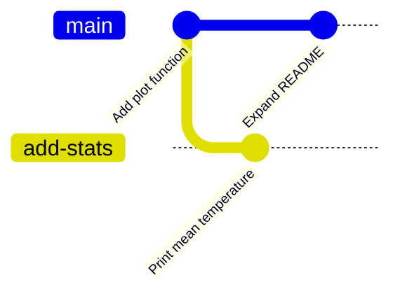
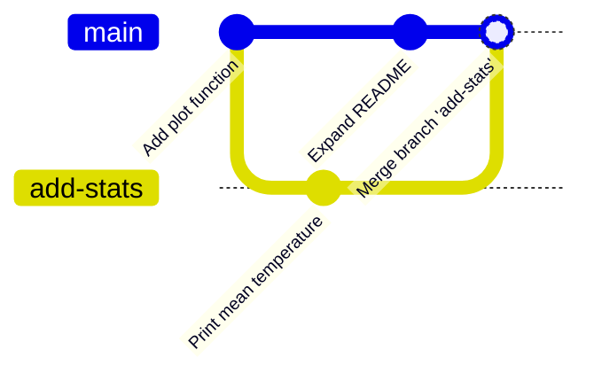
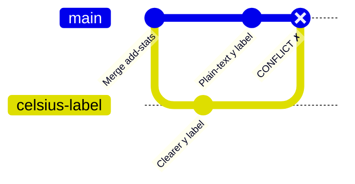
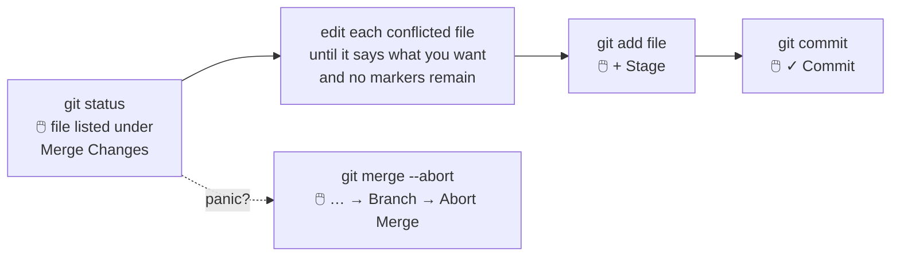
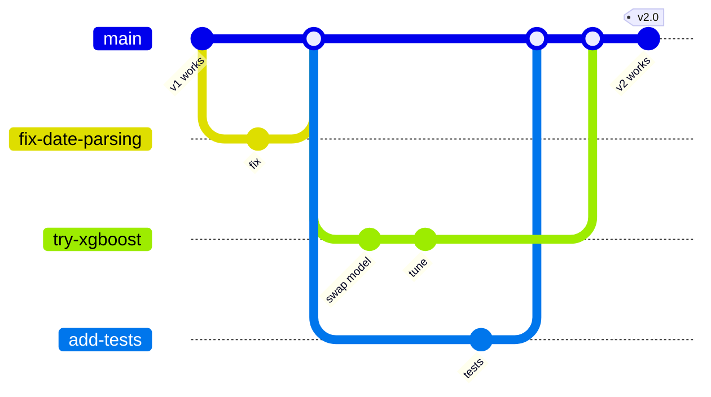

# 5 · Branches

> ⏱️ 45 min · 🎯 Create, switch and merge branches; resolve a conflict in VS Code's merge editor · ⌨️ + 🖱️

**Day 1 ▸ Lesson 5 of 5**

Branches turn Git from "a better Save As" into a collaboration tool. They are
cheap and instant, so use them freely. By Day 3, every AI agent you use will
work on a branch exactly like the ones you make here.

## 🧠 What a branch really is

A branch is just a **name that points at a commit**. `main` points at your
latest commit; committing on `main` moves the pointer forward. Create a
second name, commit on it, and the two diverge. Nothing is copied.



## 1 · Create and switch

| ⌨️ Terminal | 🖱️ VS Code |
|------------|-----------|
| `git switch -c add-plot` | click the branch name in the status bar → **+ Create new branch…** → type `add-plot` → Enter |
| `git branch` (lists, `*` marks current) | the status bar shows `⑂ add-plot` |

(`git switch -c` is the modern form. Older tutorials write
`git checkout -b add-plot`. Both work.)

Add a plotting function to `temps.py`:

```python
def plot(temps):
    import matplotlib.pyplot as plt
    plt.plot(temps)
    plt.ylabel("°C")
    plt.show()
```

Commit it: `git commit -am "Add plot function"` or stage → ✓ Commit.



Switch back and look:

| ⌨️ Terminal | 🖱️ VS Code |
|------------|-----------|
| `git switch main` then `cat temps.py` | status bar → `main`; the open file changes before your eyes |

The plot function is gone. Not lost, just not on this branch. Git swaps the
files on disk to match the branch you are on.

## 2 · Merge (fast-forward)

When a branch's work is done, bring it into `main`:

| ⌨️ Terminal | 🖱️ VS Code |
|------------|-----------|
| `git switch main` then `git merge add-plot` | be on `main` → Command Palette → **Git: Merge…** → pick `add-plot` |

```
Updating 8b1e4d2..c4d5e6f
Fast-forward
```

**Fast-forward** means `main` had nothing new, so Git simply moved the `main`
pointer forward to `add-plot`'s tip. No new commit needed.



Delete the branch; its commits now live on `main`:

| ⌨️ Terminal | 🖱️ VS Code |
|------------|-----------|
| `git branch -d add-plot` | Command Palette → **Git: Delete Branch…** |

## 3 · Merge when both sides moved (merge commit)

Real life: `main` moves on while you work.

1. `git switch -c add-stats`, append `print(f"Mean: {sum(temps_c)/len(temps_c):.1f} C")` to `temps.py`, commit *"Print mean temperature"*.
2. `git switch main`, add a line to `README.md`, commit *"Expand README"*.



3. `git merge add-stats` (or *Git: Merge…*). VS Code opens to let you confirm
   the message `Merge branch 'add-stats'`; close the tab to accept.



The result is a **merge commit** with two parents. Look at it in the Graph
or with `git log --oneline --graph --all`. Then `git branch -d add-stats`.

## 4 · Merge conflicts (the thing everyone fears)

A conflict happens when both branches changed **the same lines** of the same
file. Git cannot guess which you want, so it asks. It is a question, not an
error.

🧪 Create one on purpose:

1. `git switch -c celsius-label`; change the `plt.ylabel("°C")` line to `plt.ylabel("Temperature (°C)")`; commit *"Clearer y label"*.
2. `git switch main`; change **the same line** to `plt.ylabel("degrees C")`; commit *"Plain-text y label"*.
3. `git merge celsius-label`.

```
CONFLICT (content): Merge conflict in temps.py
Automatic merge failed; fix conflicts and then commit the result.
```



### What the file looks like

```python
<<<<<<< HEAD
    plt.ylabel("degrees C")
=======
    plt.ylabel("Temperature (°C)")
>>>>>>> celsius-label
```

| Marker | Meaning |
|--------|---------|
| `<<<<<<< HEAD` … `=======` | the version on the branch you are on (*current*) |
| `=======` … `>>>>>>> celsius-label` | the version being merged in (*incoming*) |

### Resolving it



🖱️ **In VS Code** the conflicted file shows the markers with buttons above
each block:

```
  Accept Current Change | Accept Incoming Change | Accept Both Changes | Compare Changes
<<<<<<< HEAD (Current Change)
    plt.ylabel("degrees C")
=======
    plt.ylabel("Temperature (°C)")
>>>>>>> celsius-label (Incoming Change)
                                                    [ Resolve in Merge Editor ]
```

Click **Accept Incoming Change** (or edit the lines by hand and delete the
markers). For bigger conflicts click **Resolve in Merge Editor**, which
shows three panes:

```
┌───────────── Incoming (celsius-label) ─────────┬──────────── Current (main) ────────────┐
│ ☐ Accept Incoming   plt.ylabel("Temperature…") │ ☐ Accept Current   plt.ylabel("degrees C")│
├────────────────────────── Result ──────────────┴─────────────────────────────────────────┤
│     plt.ylabel("Temperature (°C)")                  ← editable; this is what gets saved  │
│                                                                      [ Complete Merge ]  │
└──────────────────────────────────────────────────────────────────────────────────────────┘
```

Tick the side you want (or both, or type the result yourself), press
**Complete Merge**, then stage and commit as usual.

⌨️ In the terminal: open the file, keep the line you want, delete the three
marker lines, then `git add temps.py && git commit`.

> [!TIP]
> 🤖 Confused by a conflict? Select the whole block, open Copilot Chat and
> ask *"Explain this merge conflict and what each side changed."* Newer VS
> Code versions also offer a *Resolve Merge Conflict with AI* action in the
> merge editor. Treat its result like any other suggestion: read the diff
> before you commit.

Finish with `git branch -d celsius-label`.

## 5 · How people actually use branches



The near-universal convention, **feature branching**:

- `main` always works. Experiments never go straight onto it.
- Each piece of work gets a short-lived branch with a descriptive name:
  `fix-date-parsing`, `try-xgboost`, `add-tests`.
- When finished, merge into `main` (on GitHub via a pull request, lesson 7)
  and delete the branch.

🤖 This is exactly what the Copilot cloud agent does: one issue → one
`copilot/…` branch → one pull request. You will recognise everything.

## Everyday branch commands

| Command | Meaning | 🖱️ VS Code |
|---------|---------|-----------|
| `git branch` | list local branches | status bar branch menu |
| `git switch -c name` | create and switch | status bar → Create new branch… |
| `git switch name` | switch | status bar → pick a branch |
| `git switch -` | back to the previous branch | — |
| `git merge name` | merge `name` into the current branch | Command Palette → Git: Merge… |
| `git branch -d name` | delete a merged branch | Git: Delete Branch… |
| `git branch -D name` | force-delete an unmerged branch | same, confirm |
| `git branch -m newname` | rename the current branch | Git: Rename Branch… |
| `git log --oneline --graph --all` | picture of all branches | Graph section |
| `git merge --abort` | cancel a conflicted merge | … → Branch → Abort Merge |

## 🧪 Practice

1. Branch `add-tests`, add `test_temps.py` with one `assert`, commit, merge (fast-forward), delete the branch.
2. Two branches from `main`, each changing a *different* line of `README.md`. Merge both. No conflict; look at the graph.
3. Two branches changing the *same* line. Merge, resolve in the merge editor, commit.
4. Start a conflicting merge and abort it.

Next: [Day 1 exercise](day-1-exercises.md)
