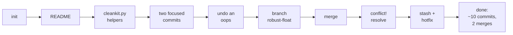
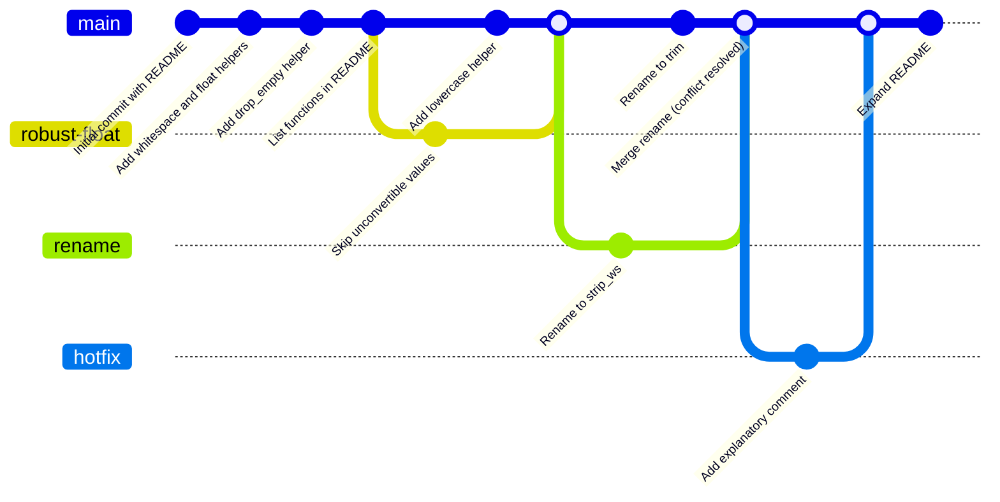

# Day 1 exercise — build a small project with a clean history

> ⏱️ 60 min · 🎯 Use everything from lessons 1–5 on a fresh project without looking at the lessons · Start a **new** repository, not `weather-project`

After each step, glance at the Source Control view and the Graph, or run
`git status` and `git log --oneline`, and confirm they show what you
expect. Hints are at the bottom; try without them first.

## What you are building



A tiny data-cleaning toolkit called `cleankit`. You will reuse it on Day 2
and Day 3, so do the steps properly.

## Steps

### 1 · Initialise
Create a folder `cleankit`, open it in VS Code, make it a repository. Confirm the status bar says `main`.

### 2 · First commit
Create `README.md` with a title and one sentence. Commit it as `Initial commit with README`.

### 3 · Add code
Create `cleankit.py`:

```python
def strip_whitespace(values):
    return [v.strip() for v in values]

def to_float(values):
    return [float(v) for v in values]
```

Commit as `Add whitespace and float helpers`.

### 4 · Two changes, two commits
Make **both** edits before committing anything:

- in `cleankit.py`, add `drop_empty(values)` returning only non-empty strings;
- in `README.md`, add a line listing the three functions.

Now create **two separate commits**: one with only the `cleankit.py` change,
one with only the README change. Verify with the Graph (or `git show HEAD`
and `git show HEAD~1`) that each commit touches exactly one file.

### 5 · A mistake, undone
Add `print("debug")` to `cleankit.py` and commit it as `oops`. Remove that
commit from history **without losing other work**. Check that `oops` is gone
from the log and the debug line is gone from the file.

### 6 · A branch for a risky idea
Create branch `robust-float`. Make `to_float` skip values that cannot be converted:

```python
def to_float(values):
    out = []
    for v in values:
        try:
            out.append(float(v))
        except ValueError:
            pass
    return out
```

Commit on the branch. Switch to `main` and confirm the old version is back.

### 7 · Main moves on
On `main`, add `lowercase(values)` at the **end** of `cleankit.py` and commit.
Before looking, sketch what the Graph will show. Then look.

### 8 · Merge
Merge `robust-float` into `main`. Conflict? (There should not be one: the
branches touched different parts of the file.) Delete the branch.

### 9 · Create and resolve a conflict
Branch `rename`: rename `strip_whitespace` to `strip_ws` and commit. On
`main`: rename the same function to `trim` and commit. Merge `rename` into
`main`, resolve in the merge editor keeping `trim`, complete the merge.

### 10 · Time travel
Check out the commit from step 3. Confirm `cleankit.py` has only two
functions. Return to `main`.

### 11 · Stash
Start editing `README.md` but do not commit. Something urgent: stash, create
branch `hotfix`, add a comment line to `cleankit.py`, commit, back to `main`,
merge `hotfix`, pop the stash, commit the README edit.

### 12 · Review
Your Graph should look roughly like this:



Read every message top to bottom. Could a stranger follow the story?

## ✅ Self-assessment

You are ready for Day 2 if you can do all of these without notes:

- [ ] Explain working directory vs. staging area vs. repository.
- [ ] Make a commit containing only one of several modified files.
- [ ] Undo the last commit, keeping the changes.
- [ ] Create a branch, commit on it, merge it, delete it.
- [ ] Resolve a merge conflict in the merge editor.
- [ ] Use `git reflog` to find a commit you "lost".

## Hints

<details>
<summary>Step 4</summary>

Stage one file at a time: hover `cleankit.py` → **+** → commit `Add drop_empty helper`; then `README.md` → **+** → commit `List available functions in README`. Terminal: `git add cleankit.py && git commit -m "…"`, then the same for README.
</details>

<details>
<summary>Step 5</summary>

`git reset --hard HEAD~1` is fine here because the only thing in that commit is the debug line you want gone. If you had other uncommitted edits to keep, you would use **Undo Last Commit** (`git reset --soft HEAD~1`), unstage, and fix the file by hand.
</details>

<details>
<summary>Step 9</summary>

After the merge reports a conflict, open `cleankit.py`, click **Accept Current Change** on the block (current = `main` = `trim`), or open the merge editor and tick *Accept Current*. Stage and commit.
</details>

<details>
<summary>Step 11</summary>

```bash
git stash
git switch -c hotfix
# edit cleankit.py
git commit -am "Add explanatory comment"
git switch main
git merge hotfix
git branch -d hotfix
git stash pop
git commit -am "Expand README"
```
</details>

Next: [6 · GitHub and remotes](../day-2/06-github-and-remotes.md)
