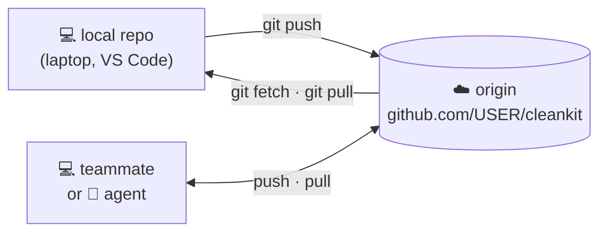
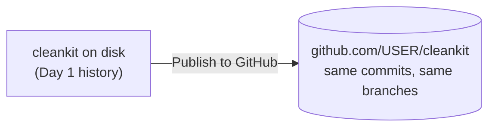
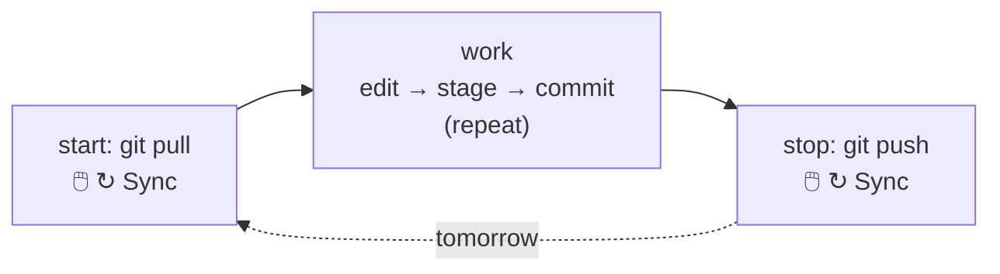
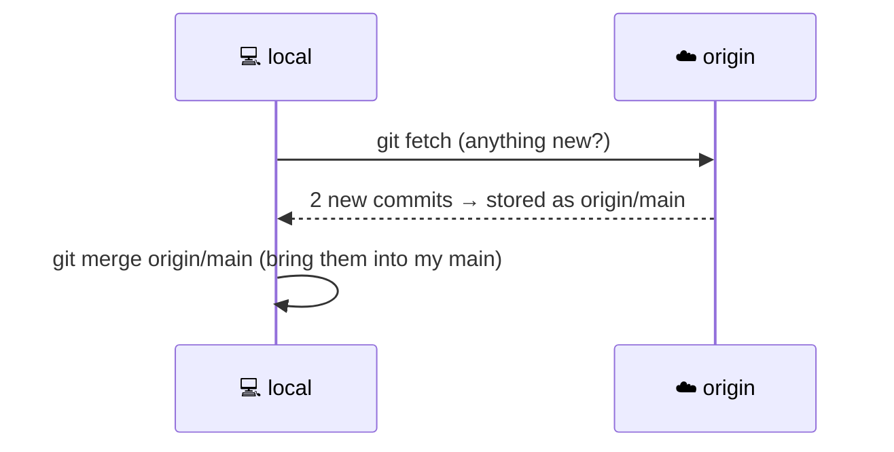
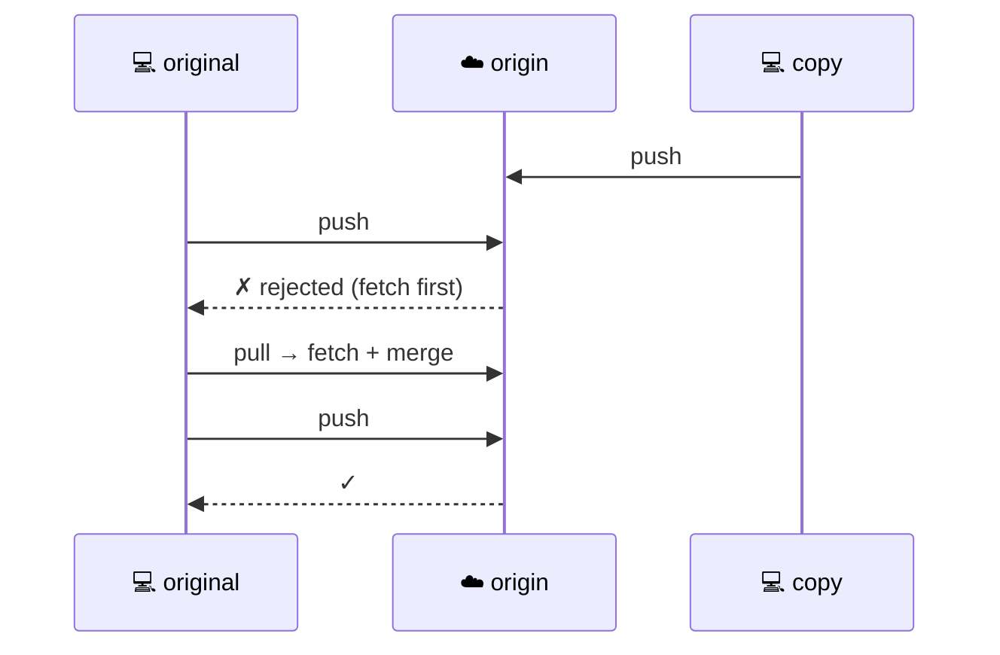

# 6 · GitHub and remotes

> ⏱️ 45 min · 🎯 Put a repository on GitHub, push, pull, clone, and handle a rejected push · ⌨️ + 🖱️ Uses the GitHub account from lesson 2

**Day 2 ▸ Lesson 6 of 9**

Day 1 happened entirely on your laptop. Today your repository gets a second
home on GitHub.

## 🧠 A remote is a named link to another copy



The default remote is called `origin`. Nothing syncs on its own: Git talks
to the remote only when you push or pull.

## 1 · Credentials: VS Code already has them

You signed in to GitHub inside VS Code in lesson 2, so VS Code can push and
pull for you. The terminal needs its own setup only if you want to run
`git push` there too:

<details>
<summary>⌨️ GitHub CLI (recommended; you will need it on Day 3)</summary>

Install from https://cli.github.com, then `gh auth login` and choose
*GitHub.com → HTTPS → Login with a web browser*. Git credentials are
configured as part of it.
</details>

<details>
<summary>⌨️ SSH key (the long-term developer setup)</summary>

Run `ssh-keygen -t ed25519 -C "you@example.com"` and accept the defaults.
Copy the contents of `~/.ssh/id_ed25519.pub` into GitHub → *Settings → SSH
and GPG keys → New SSH key*. Test with `ssh -T git@github.com`. SSH remote
addresses look like `git@github.com:USER/repo.git`.
</details>

## 2 · Publish `cleankit`



| 🖱️ VS Code | ⌨️ Terminal |
|-----------|-------------|
| Source Control view → **Publish to GitHub** → pick *private* or *public*. VS Code creates the repository, adds `origin`, and pushes `main` | On github.com: **+ → New repository**, name `cleankit`, leave it **empty** (no README, licence or `.gitignore`), create. Then: `git remote add origin https://github.com/USER/cleankit.git` and `git push -u origin main` |

`-u` ties local `main` to `origin/main`, so from now on a bare `git push`
or `git pull` knows where to go. Check with `git remote -v`.

🧪 Open the repository in the browser. Every Day 1 commit is there,
including the merges. Click **commits**, then click a commit to see its diff.

## 3 · The other direction: clone

| ⌨️ Terminal | 🖱️ VS Code |
|------------|-----------|
| `git clone https://github.com/USER/cleankit.git cleankit-copy` | Command Palette → **Git: Clone** → *Clone from GitHub* → choose the repo and a folder |

A clone brings the whole history and has `origin` preset. Clone a famous
project once to feel it: `git clone https://github.com/pandas-dev/pandas.git`
(big; delete it afterwards).

## 4 · The daily rhythm



The **↻ Sync Changes** button in the status bar runs pull *then* push. The
badge next to it, such as `↓2 ↑1`, means two commits to fetch and one to
push.

`git pull` is really two commands:



Run them separately when you want to look before merging:

```bash
git fetch
git log --oneline main..origin/main    # commits on GitHub that I do not have
git merge origin/main
```

## 5 · 🧪 The rejected push

Open `cleankit` and `cleankit-copy` in two VS Code windows and play two
people.

1. In the copy: edit `README.md`, commit, push.
2. In the original: pull. The edit arrives.
3. In the original: edit `cleankit.py` and commit, **do not push yet**. In the copy: edit `README.md` again, commit, push.
4. In the original: push.

```
 ! [rejected]  main -> main (fetch first)
hint: Updates were rejected because the remote contains work that you do not have locally.
```



Read it as: *somebody pushed since your last pull. Pull, then push.* If both
sides changed the same lines, the pull ends in a conflict, which you resolve
with the merge editor from lesson 5, then push. The Sync button does the
same sequence and surfaces the conflict the same way.

## 6 · Branches and the remote

| Task | ⌨️ Terminal | 🖱️ VS Code |
|------|------------|-----------|
| publish a new branch | `git push -u origin add-docs` | **Publish Branch** (cloud icon in the status bar) |
| see remote branches | `git branch -r` | branch menu lists `origin/…` |
| get a branch someone pushed | `git fetch` then `git switch their-branch` | branch menu → choose `origin/their-branch` |
| delete a branch on GitHub | `git push origin --delete add-docs` | Command Palette → **Git: Delete Branch…** → the remote entry |

## 7 · Rules for shared history

> [!CAUTION]
> A pushed commit may already be on someone else's machine.
> - Do not `--amend`, `reset` or `rebase` commits that are on a shared branch. Use `git revert`.
> - Do not force-push `main`. On a feature branch only you use, `git push --force-with-lease` after an amend is acceptable.
> - Pull before starting, push before stopping. Frequent small pushes mean easy merges.

## 8 · Tour of the repository page

| Looking for | Where |
|-------------|-------|
| files and the rendered README | **Code** tab |
| another branch | branch dropdown above the file list |
| history | **commits** link |
| clone address | green **Code** button |
| editing in the browser (creates a commit) | pencil icon on a file |
| issues, pull requests, Actions, settings | the tabs along the top |

## Recap

| Command | Meaning | 🖱️ VS Code |
|---------|---------|-----------|
| `git remote add origin <url>` | link to GitHub | Publish to GitHub |
| `git push -u origin <branch>` | first push of a branch | Publish Branch |
| `git push` / `git pull` | sync the current branch | ↻ Sync Changes |
| `git fetch` | download, do not merge | … → Fetch |
| `git clone <url>` | copy a remote repo | Git: Clone |
| `git branch -r` | remote branches | branch menu |
| `git push origin --delete <b>` | delete a remote branch | Git: Delete Branch… |

Next: [7 · Pull requests and collaboration](07-pull-requests-and-collaboration.md)
