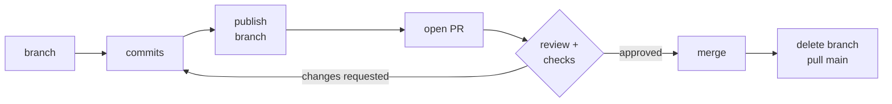
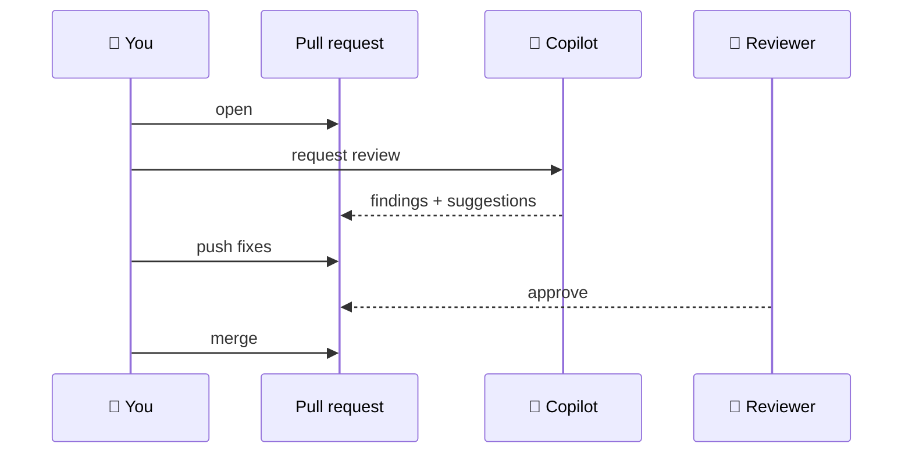
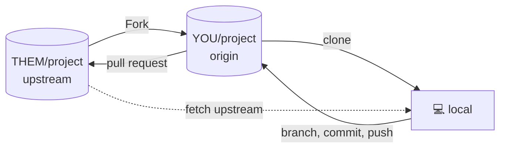

# 7 · Pull requests and collaboration

> ⏱️ 45 min · 🎯 Propose a change with a pull request, review it, connect it to an issue, get a Copilot review, and contribute to repos you do not own · 🖱️ VS Code + browser

**Day 2 ▸ Lesson 7 of 9**

A **pull request** (PR) says: *here is a branch, please review it and merge
it into `main`.* Teams, open-source projects and AI agents all work this
way. GitLab's name for it is *merge request*.

A PR is a GitHub object, not a Git command. It wraps a branch you pushed.

## 🧠 The lifecycle



## 1 · 🧪 Open a PR

In `cleankit`: sync `main`, create branch `add-usage-example`, add a usage
section to `README.md`, commit *"Add usage example to README"*, then
**Publish Branch**.

| 🖱️ VS Code (GitHub Pull Requests extension) | 🌐 Browser |
|---------------------------------------------|-----------|
| Source Control view → **Create Pull Request** icon. Confirm base `main` ← merge `add-usage-example`. Write a title and description. 🤖 The **✨** beside the title drafts both from your commits. **Create** | the push output printed a `…/pull/new/add-usage-example` link, or use the yellow **Compare & pull request** banner on the repo page |

A good description says what changed, *why*, what a reviewer should look at,
and how you tested it. `Closes #4` links issue 4 and closes it on merge.

## 2 · The PR page

| Area | Shows |
|------|-------|
| **Conversation** | description, comments, review verdicts, merge box |
| **Commits** | commits on this branch that `main` lacks |
| **Files changed** | the diff; hover a line and press **+** to comment on it |
| merge box | mergeable or conflicted; the green **Merge pull request** button |

🧪 Comment on a line in *Files changed*, then reply to yourself. In VS Code,
the GitHub view lists the PR; opening it shows the description, checks and
comments, and **Checkout** puts the PR's branch in your working copy.

## 3 · 🤖 Get a Copilot review

On the PR page, **Reviewers** → **Copilot**. A few minutes later a review
appears with inline comments and often one-click suggested fixes.
Repositories can request this automatically on every PR (Settings → Rules).
In VS Code, the PR view offers a **Code Review** button before you even
create the PR.



Treat each Copilot comment as a claim to verify, not an order.

## 4 · Respond to feedback

Commit more on the same branch and push. The PR updates by itself. Mark
handled threads **Resolved**.

## 5 · Merge and tidy up

| Merge style | What lands on `main` | Use when |
|-------------|----------------------|----------|
| Create a merge commit | every commit plus a merge commit | you want the full story |
| **Squash and merge** | one commit for the whole PR | you want a tidy `main` (most teams) |
| Rebase and merge | the commits replayed, no merge commit | you like linear history |

Press **Delete branch** on GitHub afterwards, then locally:

| ⌨️ Terminal | 🖱️ VS Code |
|------------|-----------|
| `git switch main && git pull` | branch menu → `main` → ↻ Sync |
| `git branch -d add-usage-example` | Git: Delete Branch… |
| `git fetch --prune` | … → Pull, Push → Fetch (Prune) |

## 6 · A PR with conflicts

When `main` moved while your PR was open and GitHub reports conflicts, bring
`main` into your branch locally, resolve, push:

```bash
git switch add-usage-example
git pull origin main
# resolve in the merge editor, stage, commit
git push
```

GitHub's own **Resolve conflicts** button handles small cases in the browser.

## 7 · Forks: contributing without push rights



```bash
git clone https://github.com/YOU/project.git && cd project
git remote add upstream https://github.com/THEM/project.git
# branch, commit, push to origin, open the PR against THEM/project
git switch main && git fetch upstream && git merge upstream/main && git push   # keep the fork fresh
```

Read `CONTRIBUTING.md` first and open an issue before anything bigger than
a typo fix.

## 8 · Issues

Issues are GitHub's task list. Each has a number, a thread, labels and
assignees. Mention one anywhere with `#12`; `Closes #12` in a PR description
closes it on merge.

🧪 Create issue *"Add a function that removes duplicates"* on `cleankit`.
Branch, implement, open a PR saying `Closes #1`, merge, watch the issue
close. On Day 3 you will hand an issue like this to the Copilot cloud agent
and review the PR it opens.

## 9 · Other things on the GitHub menu

| Feature | One line |
|---------|----------|
| **Actions** | automation on push, PR or schedule; the ✓ / ✗ beside commits (Day 3) |
| **Releases** | named versions built on tags (lesson 9) |
| **Codespaces** | VS Code in the browser; press `.` on any repo |
| **Pages** | static website hosting from a repo |
| **Projects, Discussions, Wiki** | board, forum, docs |
| **Dependabot** | dependency security alerts |

## Recap

- Branch → push → PR → review → merge → delete branch → pull `main`.
- Extra commits on the branch update the PR.
- Copilot can draft the description and review the diff; people decide.
- Fork when you cannot push: `origin` is yours, `upstream` is theirs.
- `Closes #N` ties a PR to an issue.

Next: [8 · Jupyter notebooks and Git](08-jupyter-notebooks-and-git.md)
