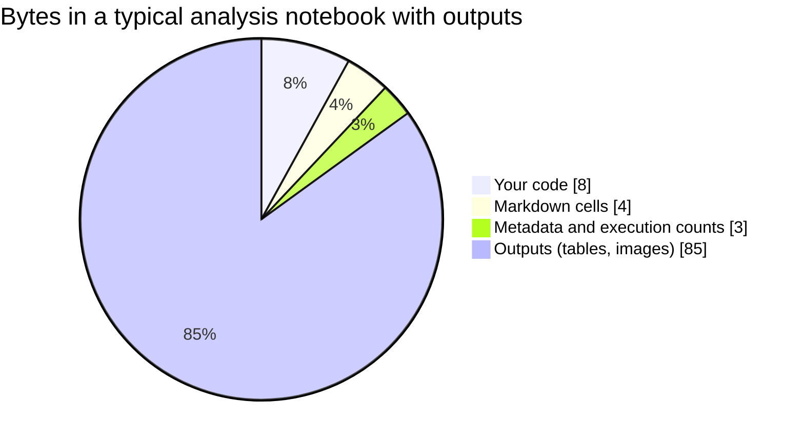
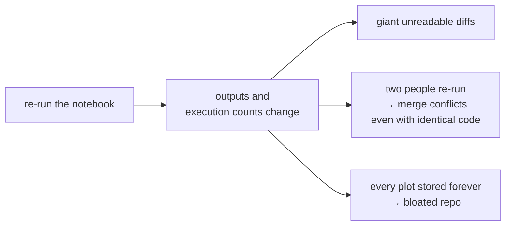
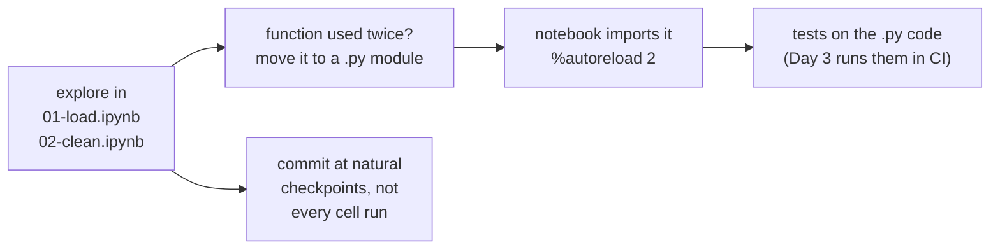

# 8 · Jupyter notebooks and Git

> ⏱️ 30 min · 🎯 Understand why notebooks fight with Git, fix it with two tools and three habits, and use VS Code's notebook diff · 🖱️ + ⌨️

**Day 2 ▸ Lesson 8 of 9**

Notebooks work with Git, but two quirks will drive you mad unless you know
about them.

## 1 · What an `.ipynb` file really is

Open a notebook in a plain text editor. It is JSON: your code, plus
execution counts, plus **every output**, including each plot as a long
base64 string.





## 2 · Fix 1: do not commit outputs

`nbstripout` strips outputs automatically whenever Git stages a notebook.
Your file on disk keeps its outputs; only the committed copy is clean.

```bash
pip install nbstripout
cd ~/cleankit
nbstripout --install          # once per repository
```

It writes a filter into `.gitattributes` and `.git/config`. From then on
notebook diffs are code diffs and merges mostly just work. Commit the
`.gitattributes` file.

No tool? *Kernel → Restart Kernel and Clear All Outputs* before every
commit. It works until you forget.

When the outputs *are* the deliverable, export a copy (*File → Save and
Export Notebook As → HTML*) and commit that instead.

## 3 · Fix 2: readable notebook diffs

🖱️ **VS Code** already has a notebook diff viewer: click a changed `.ipynb`
in the Source Control view and you see cell-by-cell changes, with a toolbar
toggle to hide output and metadata changes. Two settings make that the
default:

```json
"notebook.diff.ignoreOutputs": true,
"notebook.diff.ignoreMetadata": true
```

⌨️ For the terminal and for merges, `nbdime`:

```bash
pip install nbdime
nbdime config-git --enable --global
git diff notebook.ipynb         # now cell-based
nbdiff-web notebook.ipynb       # side-by-side in the browser
nbmerge-web notebook.ipynb      # resolve a conflicted notebook visually
```

GitHub renders notebooks and, in PRs, shows a *rich diff* for `.ipynb`
files (toggle at the top right of the file in *Files changed*).

## 4 · Fix 3: ignore the junk Jupyter creates

`.ipynb_checkpoints/` folders appear next to every notebook and must never
be committed. Lesson 9 covers `.gitignore` in full; the lines you need:

```
.ipynb_checkpoints/
__pycache__/
*.pyc
.venv/
```

## 5 · A workflow that keeps notebooks sane



| Habit | Why |
|-------|-----|
| number notebooks `01-…`, `02-…` | they sort in reading order |
| move stable code to `.py` files | Python files diff and merge perfectly; notebooks stay short |
| `%load_ext autoreload` / `%autoreload 2` in the first cell | module edits appear without restarting the kernel |
| **never commit data** | big, private, changes differently from code. Put it in `data/`, ignore it, commit a small sample or a download script |
| **never commit secrets** | keys go in `.env` (ignored) and are read with `os.environ`. A key pushed to a public repo is harvested by bots within minutes |
| commit `requirements.txt` or `environment.yml` | others, and CI, can rebuild your environment |

## 6 · Jupytext (optional)

[Jupytext](https://jupytext.readthedocs.io) pairs each notebook with a `.py`
file using `# %%` cell markers. Commit the `.py`, ignore the `.ipynb`, and
both stay in sync on save. VS Code opens `# %%` files as notebooks directly.
Adopt it once everything else here is routine.

## 🧪 Practice

1. In `cleankit`, create `notebooks/01-demo.ipynb` with two cells that import and use your functions. Run it, commit it, and look at the diff in Source Control with and without *ignore outputs*.
2. Install `nbstripout`, run `nbstripout --install`, re-run the notebook, commit again. The diff is now only code.
3. Add the four ignore lines above to `.gitignore`, commit, confirm `.ipynb_checkpoints/` no longer shows up.

Next: [9 · Good habits](09-good-habits.md)
