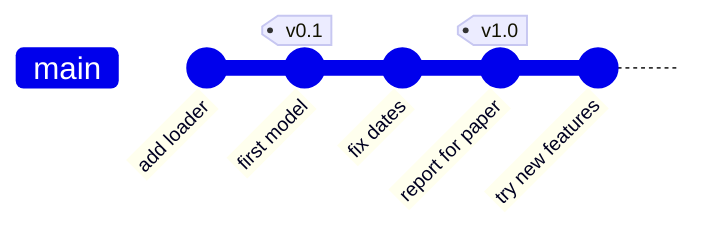

# 9 · Good habits

> ⏱️ 30 min · 🎯 Write commits people thank you for, keep junk out with `.gitignore`, structure a project, tag versions, and prepare the repo for AI helpers · ⌨️ + 🖱️

**Day 2 ▸ Lesson 9 of 9**

Everything so far was mechanics. This is about using them well.

## 1 · Commit messages

```
Fix off-by-one in rolling mean window        ← subject: ≤ 50 chars, imperative, no period
                                              ← blank line
The window included the current row twice    ← body: WHY, wrapped at 72
when center=True. Added a regression test
with a 3-row frame.

Closes #17                                    ← footer: links
```

| Rule | Test |
|------|------|
| imperative mood: *Add*, *Fix*, *Remove* | the subject completes *"If applied, this commit will ___"* |
| one logical change per commit | "Fix typo and rewrite loader" is two commits |
| body explains why, not what | the diff already shows what |

Bad: `fix`, `wip`, `changes`, `final version`. You will search this history
one day.

🤖 Copilot's ✨ button writes a decent *what*. Add the *why* yourself. Over
time the messages also become the material Copilot uses to draft PR titles
and descriptions, so quality compounds.

## 2 · `.gitignore`

A file named `.gitignore` in the repo root lists patterns Git must never
track. Commit the file itself. A solid start for Python and Jupyter:

```
# Jupyter
.ipynb_checkpoints/

# Python
__pycache__/
*.pyc
*.egg-info/
build/
dist/

# Environments
.venv/
venv/
env/

# Secrets and local config
.env
*.key

# Data and outputs
data/
*.csv
*.parquet
*.pkl
outputs/
*.log

# Editors and OS
.vscode/
.idea/
.DS_Store
Thumbs.db
```

Patterns: `name/` ignores a folder anywhere, `*.csv` an extension, `/data`
only at the root, `!keep.csv` un-ignores. GitHub offers a full Python
template when you create a repo; https://gitignore.io generates one for any
tool mix.

Already committed something before ignoring it?

```bash
git rm --cached data/big.csv      # stop tracking, keep the file on disk
git commit -m "Stop tracking data file"
```

It stays in old commits; purging history needs `git filter-repo`, beyond
this course. Hence the rule: **`.gitignore` is your second commit**, right
after the README.

## 3 · A README that answers three questions

```markdown
# cleankit

Small helpers for cleaning lists of strings before analysis.      ← WHAT

## Install
    pip install -e .                                               ← HOW

## Usage
    from cleankit import to_float
    to_float(["1.5", " 2 ", "x"])   # [1.5, 2.0]

## Layout                                                           ← WHERE NEXT
- `cleankit.py` — the library
- `notebooks/` — exploration, numbered in order
- `tests/` — run with `pytest`
```

## 4 · Layout for a data project

```
project/
├── README.md
├── .gitignore
├── requirements.txt          # or environment.yml / pyproject.toml
├── .github/
│   ├── copilot-instructions.md   # how AI helpers should work here (lesson 10)
│   └── workflows/                # automation (lesson 12)
├── data/                     # ignored; README inside says how to get it
├── notebooks/
│   ├── 01-explore.ipynb
│   └── 02-model.ipynb
├── src/ or project_name/     # reusable .py code
└── tests/
```

## 5 · Tags and releases

A **tag** is a permanent name for one commit, used for versions.



```bash
git tag -a v1.0 -m "Version used for the October report"
git push origin v1.0            # tags are not pushed by default
git checkout v1.0               # look at that version later
```

🖱️ Source Control **…** → *Tags* → **Create Tag**. On GitHub, *Releases →
Draft a new release* turns a tag into a page with notes and downloads. Tag
the exact commit behind any report or paper.

## 6 · Small things experienced people do

- `git status` before every commit; `git diff --staged` before any commit of consequence.
- Commit early and often. A commit is free; a lost afternoon is not.
- Pull before starting, push before stopping.
- Branch names: short, lowercase, hyphenated, descriptive. `fix-nan-handling`, not `stuff`.
- Never commit generated files, data, or credentials. If a credential slipped out, rotate it at once; deleting it from history is not enough once pushed.
- Keep `main` working. Experiments live on branches.
- Aliases for what you type most (stored in `~/.gitconfig`):

```bash
git config --global alias.st status
git config --global alias.lg "log --oneline --graph --all"
git config --global alias.sw switch
```

## 7 · Licences for public repos

Without a licence file, others technically may not reuse your code even if
it is public. For personal projects **MIT** is the usual choice. GitHub
offers templates under *Add file → Create new file → `LICENSE`*;
https://choosealicense.com explains the options.

## 8 · 🤖 Prepare the repo for AI helpers

A file at `.github/copilot-instructions.md` tells Copilot (in VS Code and
the cloud agent) how this project works: Python version, how to run tests,
conventions, what never to touch. Lesson 10 gives you a template. Having
one is the difference between an agent that guesses and one that follows
your rules.

Next: [Day 2 exercise](day-2-exercises.md)
