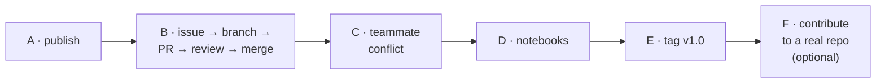

# Day 2 exercise — publish and collaborate

> ⏱️ 60 min · 🎯 Put `cleankit` on GitHub, run a full pull-request cycle with an issue, survive a teammate conflict, make notebooks behave, tag a version · Uses the `cleankit` repo from Day 1



## Part A — Publish

1. Add a Python/Jupyter `.gitignore` (lesson 9) and commit it.
2. **Publish to GitHub** from VS Code (or create an empty repo and push).
3. On GitHub, confirm the Day 1 history is all there. Open the
   conflict-resolution merge commit and read its diff.

## Part B — A full pull-request cycle

4. Open an **issue**: *"Add `dedupe()` to remove duplicate values while preserving order."*
5. Locally: sync, create branch `add-dedupe`, implement:

   ```python
   def dedupe(values):
       seen = set()
       out = []
       for v in values:
           if v not in seen:
               seen.add(v)
               out.append(v)
       return out
   ```

   Commit with a proper subject and a body that references the issue.
6. Publish the branch and open a PR from VS Code. Let the ✨ draft the
   description, then edit it and add `Closes #1`.
7. Request a **Copilot** review on GitHub. Read what it says.
8. On *Files changed*, leave yourself a comment asking for a docstring. Add it, commit, push; the PR updates.
9. **Squash and merge**. Delete the branch on GitHub. Confirm the issue closed itself.
10. Locally: switch to `main`, sync, delete `add-dedupe`, fetch with prune. The Graph shows one squashed commit for the whole PR.

## Part C — A teammate and a conflict

11. Clone the repo a second time into `cleankit-teammate` and open it in a second VS Code window.
12. In **both** clones, change the first line of `README.md` to something different and commit. Do not push yet.
13. Push from the teammate clone. Then sync the original and read the rejection, then the conflict.
14. Resolve in the merge editor, commit, push. Check the README on GitHub.
15. Sync the teammate clone. Both agree.

## Part D — Notebooks

16. Install `nbstripout`, run `nbstripout --install`, commit `.gitattributes`.
17. Create `notebooks/01-demo.ipynb` showing every function on a sample list. Run all cells. Commit and push.
18. Open the notebook on GitHub: no outputs, because the filter stripped them. (Outputs present? `git status`; the notebook was probably added before the filter was installed.)

## Part E — Version it

19. Rewrite the README with the lesson 9 template, documenting all functions.
20. Add `requirements.txt` (it may contain only `nbstripout`).
21. Commit, create annotated tag `v1.0`, push the tag, and draft a Release on GitHub with one sentence of notes.

## Part F — Contribute to a real repo (optional, 15 min)

22. Fork https://github.com/firstcontributions/first-contributions (it exists for exactly this), clone your fork, branch, follow its README, push, open a PR against the original.

## ✅ Self-assessment

- [ ] I can put a local project on GitHub and clone it elsewhere.
- [ ] I know what to do when a push is rejected.
- [ ] I can open, update, review and merge a PR, and link it to an issue.
- [ ] I can resolve a conflict that arrives through a pull.
- [ ] My notebooks commit without outputs and my data stays out of the repo.
- [ ] I can tag a version and find it again.

Next: [10 · Copilot in your Git loop](../day-3/10-copilot-in-your-git-loop.md)
