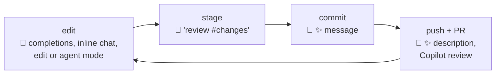
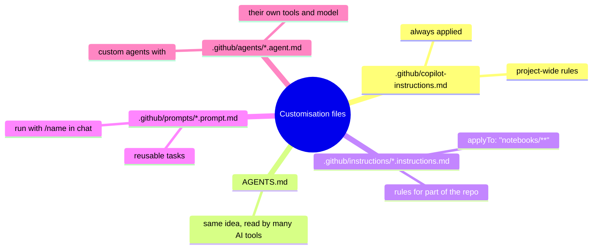

# 10 · Copilot in your Git loop

> ⏱️ 40 min · 🎯 Use Copilot for commit messages, pre-commit review, explaining history, and multi-file edits you still control; teach it the rules of your repo · 🖱️ VS Code with Copilot signed in

**Day 3 ▸ Lesson 10 of 12**

Day 3 is where the Git skills pay off. This lesson keeps you in the
driver's seat: Copilot proposes, Git shows you exactly what it proposed, you
decide what gets committed.

## 🧠 Where Copilot plugs into the loop



Nothing changes about Git. Every Copilot output lands in your working
directory as an ordinary change you can diff, stage, discard or commit.

## 1 · The three chat modes

Open Chat with `Ctrl+Alt+I` (Mac `⌃⌘I`). The dropdown at the bottom picks a
mode:

| Mode | What it does | Use it for |
|------|--------------|-----------|
| **Ask** | answers questions, suggests code, changes nothing | "what does this error mean?", "explain this diff" |
| **Edit** | edits the files you point it at, shows a diff to accept or reject | targeted changes across a few files |
| **Agent** | plans, edits any file, runs terminal commands (asks first), iterates on errors | multi-step tasks: "add tests for cleankit and make them pass" |

Context you can hand it: `#file` (a file), `#selection`, `#changes` (your
uncommitted changes), `#codebase` (search the whole repo), `@workspace`.

## 2 · Five recipes

### ✨ Commit message
Stage your changes → click the sparkle in the message box → edit the result
to add the *why*. Already in your hands since lesson 3.

### 🔍 Review before you commit
In Ask mode:

> Review `#changes` for bugs, missing edge cases and anything that should
> have a test. Be specific about line numbers.

Fix what is real, stage, commit. This is the cheapest code review you will
ever get.

### 📖 Explain history
Select a commit in the Graph, open its diff, then in chat:

> Explain what `#file` changes and why someone might have made this change.

Or paste the output of `git log --oneline -20` and ask for a summary of the
week's work.

### 📝 PR description
Lesson 7's ✨ next to the PR title. Works best when commit messages are good.

### 🛠️ A multi-file change you still control
Switch to **Agent** mode:

> Add a `tests/test_cleankit.py` with pytest tests for every function in
> `cleankit.py`, then run the tests and fix any failures.

Agent mode edits files and asks before each terminal command. When it
finishes, the Source Control view lists every file it touched. **Read the
diffs like a reviewer**, discard what you dislike, stage the rest, commit.

> [!TIP]
> Do agent work on a branch. If the result is a mess, `git switch main` and
> delete the branch; nothing happened.

## 3 · Copilot in the terminal

**GitHub Copilot CLI** is a terminal agent (generally available since early
2026). Install it from https://github.com/github/copilot-cli and run
`copilot` inside a repository. Ask it things like *"which commits touched
`to_float` this month?"* or *"create a branch, move the helpers into a
package, and run the tests"*. Prefix a prompt with `&` to hand the task to
the cloud agent (lesson 11) and keep working.

## 4 · 🧠 Teach Copilot your repo

Every suggestion improves when Copilot knows your conventions. VS Code and
the cloud agent read these files:



| File | Scope | Typical content |
|------|-------|-----------------|
| `.github/copilot-instructions.md` | whole repo, always on | how to run, test, style, what not to touch |
| `AGENTS.md` (repo root) | whole repo; also read by Copilot CLI, Codex, Claude Code and others | same as above when you use several tools |
| `.github/instructions/<name>.instructions.md` | files matched by `applyTo` in its front matter | notebook rules, data-handling rules |
| `.github/prompts/<name>.prompt.md` | on demand via `/name` | "write a regression test for the selected function" |
| `.github/agents/<name>.agent.md` | a named agent you pick in the chat dropdown | a reviewer agent limited to read-only tools |

In chat, `/init` scaffolds `copilot-instructions.md` from your codebase.
Here is a starter for a Python/Jupyter project; adapt and commit it:

```markdown
# Copilot instructions for cleankit

## Project
Small Python library (cleankit.py) plus exploratory notebooks in notebooks/.
Python 3.12. Dependencies in requirements.txt.

## How to run and test
- Install: pip install -r requirements.txt
- Tests: pytest (all tests must pass before a change is finished)

## Conventions
- Pure functions with type hints and docstrings; no side effects.
- Notebooks are for exploration only. Reusable code goes into cleankit.py.
- Never commit data files, notebook outputs, or anything in .env.
- Keep pull requests small and focused on one issue.

## When unsure
Ask in the pull request instead of guessing.
```

## 🧪 Practice

1. Commit the instructions file above to `cleankit` on a branch via a PR.
2. In Agent mode, ask for pytest tests for `cleankit.py`. Review the diffs, discard anything odd, commit.
3. Make a deliberate bug (`to_float` returning strings). Ask Copilot to *"review #changes"*. Did it catch it?
4. Create `.github/prompts/regression-test.prompt.md` with a prompt that writes a test for the selected function, and run it with `/regression-test`.

Next: [11 · Delegating to the Copilot cloud agent](11-copilot-cloud-agent.md)
