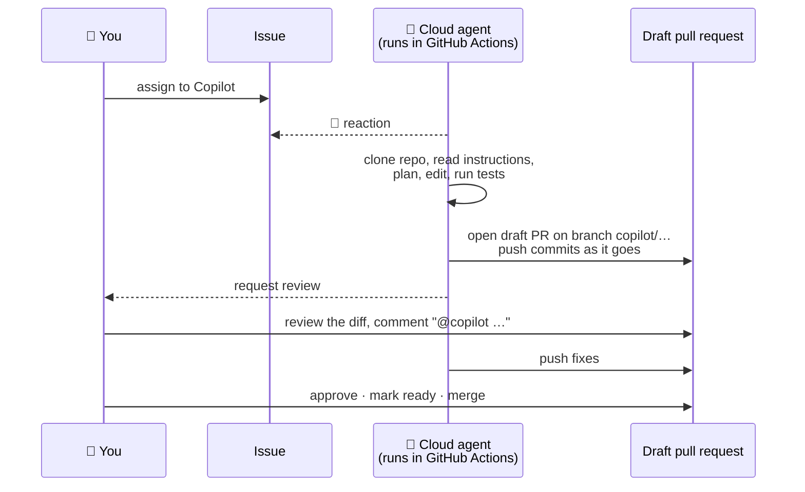
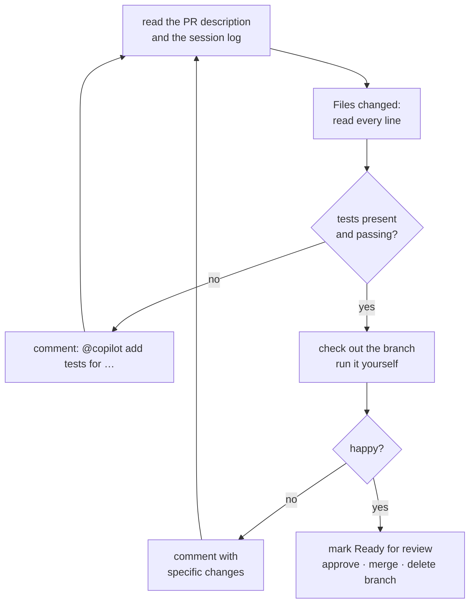
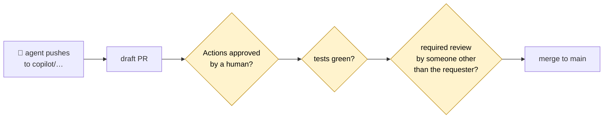

# 11 · Delegating to the Copilot cloud agent

> ⏱️ 45 min · 🎯 Hand an issue to an agent, watch it work, review its pull request, iterate, and set guardrails so nothing merges without you · 🌐 GitHub + 🖱️ VS Code · Needs a paid Copilot plan

**Day 3 ▸ Lesson 11 of 12**

Lesson 10 kept Copilot on your laptop. Now you delegate a whole task to an
agent that runs on GitHub's servers and comes back with a pull request.

> [!NOTE]
> GitHub renamed the **Copilot coding agent** to the **Copilot cloud agent**
> in 2026. Older articles and some menus still say "coding agent". Same
> thing.

## 🧠 What happens when you assign an issue



Everything the agent produces is ordinary Git: a branch named `copilot/…`,
commits, a pull request. Your Day 1 and Day 2 skills are exactly what you
need to review it.

## 1 · Ways to start a task

| From | How |
|------|-----|
| **github.com issue** | Assignees (right sidebar) → **Copilot** |
| **github.com Agents page** | github.com/copilot/agents → describe the task, pick the repo |
| **VS Code Chat** | type the task and add `#copilotCodingAgent`, or use *Delegate to coding agent* next to the send button (needs the GitHub Pull Requests extension) |
| **Copilot CLI** | prefix the prompt with `&` |
| **GitHub CLI** | `gh issue edit 12 --add-assignee "@copilot"` (if the assignment does not stick, use the web UI; the API route is GraphQL) |
| **Jira, mobile app** | assign to Copilot there |

## 2 · Write a task an agent can finish

The agent reads the issue title, body and existing comments **at the moment
you assign it**. Comments added later go on the PR instead. A good task
looks like a good ticket for a new colleague:

```markdown
## Goal
Add `dedupe(values)` to cleankit.py that removes duplicates while keeping
the first occurrence order.

## Acceptance criteria
- [ ] `dedupe(["a", "b", "a"]) == ["a", "b"]`
- [ ] Works for an empty list
- [ ] Tests added in tests/test_cleankit.py and `pytest` passes
- [ ] Function listed in README.md

## Constraints
- Pure Python, no new dependencies
- Do not change existing function signatures
```

Small, specific, testable. Large vague tasks produce large vague PRs.

## 3 · While it works

- The issue gets a 👀 reaction; a draft PR appears within minutes with a
  link to the **session log** (*View session*) where you can watch the
  agent's reasoning and commands.
- The PR description updates as it goes.
- Your test workflows (lesson 12) do **not** run automatically on the
  agent's commits by default: a person with write access must press
  **Approve and run workflows** on the PR. Repository admins can switch this
  off; keep it on while you are learning.

## 4 · Review it like a human PR, only more so



Checklist for agent PRs:

- [ ] Does it do only what the issue asked? (Scope creep is the top failure.)
- [ ] Are there tests, and did you see them pass in Actions or locally?
- [ ] Did it touch files it should not have: data, config, workflows?
- [ ] Did it add dependencies? Are they real packages?
- [ ] Do commit messages and the PR description make sense?

To iterate, comment on the PR and mention `@copilot` with the change you
want. It pushes further commits to the same branch.

🖱️ In VS Code: GitHub view → the PR → **Checkout** → run `pytest` and the
notebook yourself before approving.

## 5 · Set the repo up for agents

**Instructions** (lesson 10): `.github/copilot-instructions.md` is read by
the cloud agent on every task.

**Environment**: a workflow file that preinstalls your dependencies so the
agent can run tests. The job *must* be named `copilot-setup-steps`:

```yaml
# .github/workflows/copilot-setup-steps.yml
name: Copilot setup steps
on:
  workflow_dispatch:
  push:
    paths: [".github/workflows/copilot-setup-steps.yml"]
jobs:
  copilot-setup-steps:
    runs-on: ubuntu-latest
    permissions:
      contents: read
    steps:
      - uses: actions/checkout@v4
      - uses: actions/setup-python@v5
        with:
          python-version: "3.12"
      - run: pip install -r requirements.txt pytest
```

**Tools**: the agent can be given MCP servers (databases, docs, APIs) in
the repository's Copilot settings. Not needed for this course.

## 6 · Guardrails: nothing merges without you



Set these in *Settings → Rules → Rulesets* for `main`:

| Rule | Effect |
|------|--------|
| Require a pull request before merging | nobody, human or agent, pushes to `main` directly |
| Require approvals (1+) | the person who assigned the agent cannot be the approver; GitHub enforces this |
| Require status checks to pass | the tests from lesson 12 must be green |
| Block force pushes | history on `main` is never rewritten |

Add a `CODEOWNERS` file to make specific people required reviewers for
specific paths. Keep **Approve and run workflows** on. The agent cannot
merge its own PR.

## 7 · Plans, cost, and other agents

- The cloud agent needs a paid Copilot plan (Pro, Pro+, Business or
  Enterprise). Usage is metered; GitHub changed its billing model in 2026,
  so check https://github.com/features/copilot/plans for the current rules.
- **Agent HQ / mission control** (announced October 2025) lets you run and
  monitor several agents from GitHub, VS Code and the CLI, including
  **Claude** and **OpenAI Codex** alongside Copilot on higher-tier plans.
  Different brains, identical Git workflow: branch, commits, pull request.
- **Claude Code** (terminal, VS Code extension, web) and similar tools work
  the same way and read `AGENTS.md` or their own instruction file. If you
  ever switch, Days 1 and 2 transfer unchanged.

## 🧪 Practice

1. Add the ruleset above to `cleankit` (require PR + 1 approval + status checks once lesson 12's tests exist).
2. Commit `copilot-setup-steps.yml`.
3. Write the `dedupe` issue from section 2 (or a new function) and assign it to Copilot.
4. Watch the session log. Approve the workflows. Review the PR with the checklist. Ask for one change via `@copilot`. Merge.
5. Pull `main` locally and read the squashed commit.

No paid plan? Do the same task with **Agent mode** in VS Code on a branch,
then open the PR yourself and request a Copilot review. The review and
guardrail steps are identical.

Next: [12 · Scheduling and orchestration with GitHub Actions](12-github-actions-scheduling-orchestration.md)
