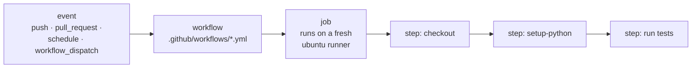
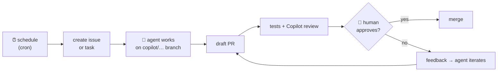
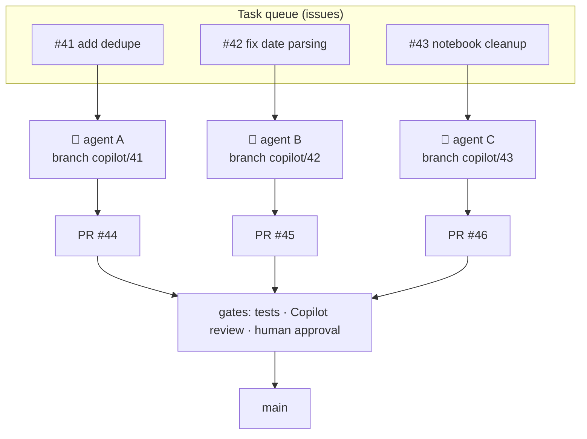

# 12 · Scheduling and orchestration with GitHub Actions

> ⏱️ 60 min · 🎯 Run tests on every pull request, run a notebook on a nightly schedule, schedule AI tasks, and orchestrate agents safely · 🌐 GitHub + 🖱️ VS Code

**Day 3 ▸ Lesson 12 of 12**

**GitHub Actions** runs scripts for you on GitHub's machines when something
happens: a push, a pull request, a timer. It is how tests gate pull requests,
how reports get regenerated overnight, and how AI agents get started on a
schedule.

## 🧠 Anatomy



A workflow is a YAML file in `.github/workflows/`. It names its triggers
(`on:`), one or more jobs, and the steps each job runs. Commit it like any
other file; it is live as soon as it is on `main`.

## 1 · Workflow 1: tests on every pull request

```yaml
# .github/workflows/tests.yml
name: Tests
on:
  pull_request:
  push:
    branches: [main]
jobs:
  test:
    runs-on: ubuntu-latest
    steps:
      - uses: actions/checkout@v4
      - uses: actions/setup-python@v5
        with:
          python-version: "3.12"
      - run: pip install -r requirements.txt pytest
      - run: pytest
```

🧪 Add it on a branch, open a PR, and watch the **Checks** section on the PR
page turn into a ✓ or ✗. Click *Details* to read the log. Then make it a
required status check in your ruleset (lesson 11): from now on, no PR merges
with failing tests, whether a person or an agent wrote it.

## 2 · Scheduling: cron

```yaml
on:
  schedule:
    - cron: "15 6 * * 1-5"     # 06:15 UTC, Monday to Friday
  workflow_dispatch:           # also allow "Run workflow" by hand
```

```
 ┌───────── minute (0–59)
 │ ┌─────── hour (0–23, UTC)
 │ │ ┌───── day of month (1–31)
 │ │ │ ┌─── month (1–12)
 │ │ │ │ ┌─ day of week (0–6, Sunday = 0)
 * * * * *
```

| Expression | Meaning |
|------------|---------|
| `0 * * * *` | every hour |
| `*/30 * * * *` | every 30 minutes |
| `15 6 * * 1-5` | 06:15 UTC on weekdays |
| `0 2 * * 0` | Sundays at 02:00 UTC |
| `0 9 1 * *` | 09:00 UTC on the first of each month |

> [!WARNING]
> - Times are **UTC**. Convert from your time zone.
> - Runs can start minutes late when GitHub is busy; the minimum interval is 5 minutes.
> - Scheduled workflows only run from the **default branch**, and GitHub disables them in public repos after 60 days without activity.
> - Always add `workflow_dispatch` so you can test without waiting for the clock.

## 3 · Workflow 2: a notebook, every night

```yaml
# .github/workflows/nightly-report.yml
name: Nightly report
on:
  schedule:
    - cron: "15 6 * * 1-5"
  workflow_dispatch:
jobs:
  run-notebook:
    runs-on: ubuntu-latest
    steps:
      - uses: actions/checkout@v4
      - uses: actions/setup-python@v5
        with:
          python-version: "3.12"
      - run: pip install -r requirements.txt jupyter nbconvert
      - run: jupyter nbconvert --to html --execute notebooks/02-report.ipynb --output-dir out
      - uses: actions/upload-artifact@v4
        with:
          name: report
          path: out/
```

Every weekday morning the notebook is executed from scratch on a clean
machine and the HTML lands as a downloadable **artifact** on the run page.
That is also the ultimate reproducibility test: if it fails there, something
only worked on your laptop.

Want the report committed back to the repo instead? Give the job
`permissions: contents: write` and add a final step:

```yaml
      - run: |
          git config user.name "github-actions[bot]"
          git config user.email "github-actions[bot]@users.noreply.github.com"
          git add out/ && git commit -m "Update nightly report" || echo "nothing changed"
          git push
```

Secrets such as API keys go in *Settings → Secrets and variables → Actions*
and are used as `${{ secrets.MY_KEY }}`. Never in the YAML, never in the
notebook.

## 4 · Workflow 3: scheduling AI work

The pattern is always the same: a timer opens a task, an agent turns it into
a pull request, the guardrails from lesson 11 decide whether it merges.



### Option A — a plain workflow that opens an issue for the agent

```yaml
# .github/workflows/weekly-chore.yml
name: Weekly chore
on:
  schedule:
    - cron: "0 7 * * 1"
  workflow_dispatch:
jobs:
  open-task:
    runs-on: ubuntu-latest
    steps:
      - env:
          GH_TOKEN: ${{ secrets.AGENT_TASK_TOKEN }}
        run: |
          gh issue create --repo "$GITHUB_REPOSITORY" \
            --title "Weekly: refresh README stats and fix stale links" \
            --body "Update the numbers in README.md from data/summary.csv and fix any broken links. Keep the change small."
          # then assign the new issue to Copilot, e.g. with gh issue edit --add-assignee "@copilot"
```

The catch: the workflow's built-in `GITHUB_TOKEN` is **not allowed** to
assign Copilot. You need a fine-grained personal access token with write
access to issues, pull requests, contents and Actions, stored as a secret.
Exact assignment commands have changed over time, so test it by hand first.

### Option B — GitHub Agentic Workflows (purpose-built, experimental)

**GitHub Agentic Workflows** (`gh-aw`, from GitHub Next) lets you write the
*task itself* in Markdown with a schedule in its front matter. It compiles
to a normal Actions workflow that runs Copilot, Claude or Codex with
sandboxing and "safe outputs" (the agent may only create issues, comments
or PRs through a vetted channel).

```bash
gh extension install github/gh-aw
gh aw init                 # pick an engine and set the repo up
gh aw add <workflow>       # start from a catalogue workflow, e.g. a daily status report
gh aw compile              # Markdown → .github/workflows/*.lock.yml
```

A workflow file looks roughly like this (check the docs for current syntax):

```markdown
---
on:
  schedule:
    - cron: "0 8 * * 1"
  workflow_dispatch:
permissions:
  contents: read
  issues: read
  pull-requests: read
engine: copilot
safe-outputs:
  create-issue:
    title-prefix: "[weekly] "
---

# Weekly repo status

Summarise what changed in this repository in the last 7 days: merged pull
requests, open issues and failing workflows. Open one issue with the summary
and three suggested next steps.
```

The project is young and changes fast; read https://github.github.com/gh-aw
before relying on it.

### Option C — other agents on a schedule

Claude Code offers scheduled tasks on the web and a GitHub Action that
reacts to `@claude` mentions in issues and PRs. Codex and others have
equivalents. The Git side never changes: branch, PR, review, merge.

## 5 · Orchestration patterns



| Pattern | Rule |
|---------|------|
| **One issue, one branch, one PR** | never let two agents work on the same branch |
| **Small tasks** | an agent PR should be reviewable in ten minutes |
| **Protected main** | the rulesets from lesson 11, always |
| **CI is the safety net** | tests run on every PR; a red check blocks the merge |
| **Sequence through issues** | if task B needs task A, open B after A merges, or state the dependency in B |
| **Humans approve** | you review every agent PR; the requester is not the approver |
| **Watch the meter** | agents cost money per run; start with one weekly job |
| **Least privilege** | tokens for automation get only the permissions they need |

Monitoring lives in three places: the **Actions** tab (every run and its
log), the **Pull requests** tab filtered by `author:app/copilot-swe-agent`,
and the **Agents** page / mission control for sessions.

## 🧪 Practice

1. Add `tests.yml`. Open a PR with a failing test, watch it go red, fix it, watch it go green. Make the check required.
2. Add `nightly-report.yml` with `workflow_dispatch`, run it by hand from the Actions tab, download the artifact.
3. Create a fine-grained token, store it as `AGENT_TASK_TOKEN`, and get `weekly-chore.yml` to open an issue. Assign Copilot by hand if the automatic assignment does not work yet.
4. (Stretch) Install `gh-aw` and add the daily status workflow.

Next: [Day 3 exercise](day-3-exercises.md)
