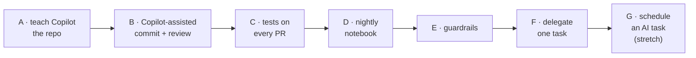

# Day 3 exercise — automate `cleankit` end to end

> ⏱️ 60 min · 🎯 Instructions file, Copilot-assisted commits and review, tests in CI, a scheduled notebook run, and one delegated task · Uses `cleankit` on GitHub

## Part A — Teach Copilot the repo

1. On a branch, add `.github/copilot-instructions.md` (lesson 10 template, adapted). Open a PR, request a Copilot review, merge.
2. Add `.github/prompts/regression-test.prompt.md` and try `/regression-test` on `to_float`.

## Part B — Copilot-assisted commit and review

3. In Agent mode on branch `add-tests`: *"Add pytest tests for every function in cleankit.py and make them pass."* Review each diff in Source Control. Discard anything you do not understand.
4. Stage, generate the commit message with ✨, add the *why*, commit.
5. Introduce a deliberate bug, ask Copilot to review `#changes`, confirm it notices, discard the bug.

## Part C — Tests on every pull request

6. Add `.github/workflows/tests.yml` (lesson 12). Push the branch, open the PR, let the ✨ write the description, watch the check run.
7. Merge. In *Settings → Rules*, create a ruleset for `main`: require PR, require 1 approval, require the `test` status check, block force pushes.

## Part D — Nightly notebook

8. Create `notebooks/02-report.ipynb` that imports `cleankit`, cleans a small inline sample, and prints a summary table.
9. Add `nightly-report.yml` with a cron for 07:00 in *your* time zone (converted to UTC) plus `workflow_dispatch`. Run it manually from the Actions tab and download the artifact.

## Part E — Guardrails check

10. Try to push a commit straight to `main`. It should be rejected by the ruleset. Good. Open a PR instead.

## Part F — Delegate one task

11. Open an issue using the lesson 11 template: *"Add `normalize_whitespace(values)` that collapses internal runs of spaces to one."* Assign it to Copilot.
12. Approve the workflows on its PR, read the session log, review with the checklist, request one change via `@copilot`, approve, merge.

No paid plan? Do step 11 with Agent mode in VS Code on a branch and open the PR yourself, then request a Copilot review.

## Part G — Schedule an AI task (stretch)

13. Either get `weekly-chore.yml` to open and assign an issue with a fine-grained token, or install `gh-aw` and add a daily status workflow. Run it manually once. Review whatever it produces as you would any PR.

## ✅ Self-assessment

- [ ] Copilot drafts my commit messages and PR descriptions, and I always edit them.
- [ ] I can review an agent's multi-file change through the Source Control diffs before committing.
- [ ] Every PR on my repo runs tests, and a red check blocks merging.
- [ ] A notebook runs on a schedule on GitHub's machines and I can fetch the result.
- [ ] I can assign an issue to an agent, review its PR with the checklist, and iterate with `@copilot`.
- [ ] Nothing reaches `main` without a passing check and an approval from someone other than the requester.

Finish with the [self-check quiz](../self-check-quiz.md), then keep the
[cheat sheets](../cheatsheets/) where you will find them.
